# Movie Search App (Week 4 Project)

A React app for searching films, series and games using the [OMDb API](https://www.omdbapi.com/). Search for a title, narrow the results by type or year, page through them, open a title to see its full details, and save favorites that stay after a page reload. Searches live in the URL, so any results page can be bookmarked or shared. The app has a light and dark theme and works on phones and desktops.

Live demo: https://mctaba-movie-search-app-njs5.vercel.app/

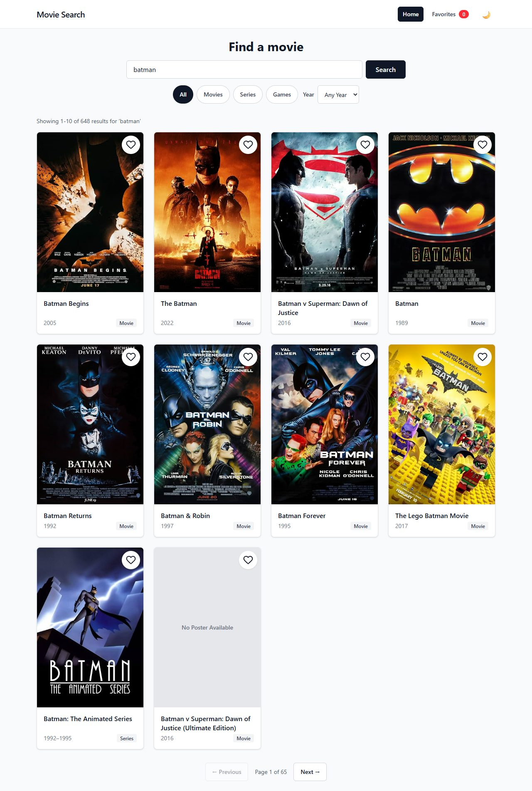

## Requirements checklist

| Requirement | How the app meets it | Screenshot |
| --- | --- | --- |
| Search movies with the OMDb API | The search bar calls OMDb's search endpoint (`s=`). Submitting an empty box shows "Please enter a movie title to search." | [Search results](#search) |
| Show results in a responsive grid | Poster, title, year and type on each card. 1 column on phones, 2 on tablets, 4 on desktops. Missing posters show "No Poster Available" | [Search results](#search), [Mobile](#responsive-layout) |
| Movie details page | `/movie/:id` reads the IMDb ID from the URL and shows the poster, IMDb rating, full plot, age rating, runtime, genre, director and actors | [Details](#movie-details-page) |
| Routing between pages | React Router with Home (`/`), Details (`/movie/:id`) and Favorites (`/favorites`). The header highlights the current page | [Details](#movie-details-page) |
| Favorites saved in `localStorage` | Heart button on every card and on the details page. The header shows a live count | [Favorites](#favorites) |
| Loading and error states | Spinner while fetching. Clear messages for no results, an unknown movie ID and network failures | [Errors](#loading-and-error-states) |
| **Extra:** Pagination | Previous / Next buttons, "Page 2 of 65", and "Showing 11–20 of 648 results" from `totalResults` | [Pagination](#pagination) |
| **Extra:** Type filter | All / Movies / Series / Games buttons that re-run the search with `type=` | [Filters](#type-and-year-filters) |
| **Extra:** Year filter | A year dropdown that re-runs the search with `y=` | [Filters](#type-and-year-filters) |
| **Extra:** Share movie link | Share button copies the page URL with `navigator.clipboard.writeText` and shows "Link copied!" | [Share](#share-a-movie) |
| **Extra:** Search history | The last 10 searches are saved and shown as suggestions under the search bar. Clicking one runs it | [History](#search-history) |
| **Extra:** Dark mode | Header toggle using Tailwind's `dark:` variant. The choice is saved and applied before the page paints | [Dark mode](#dark-mode) |

## Features and screenshots

### Search

Type a title and press **Search** or <kbd>Enter</kbd>. The results count comes from OMDb's `totalResults`. The search term is stored in the URL (`/?q=batman`), so refreshing the page or sharing the link shows the same results.

| Start screen | Results |
| --- | --- |
| 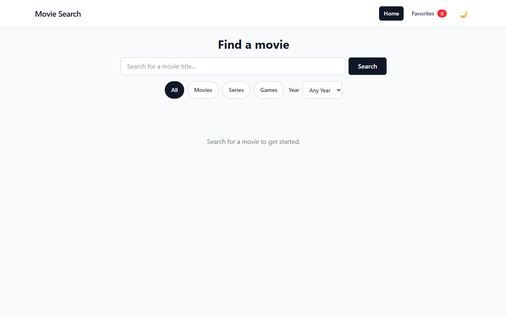 |  |

### Pagination

OMDb returns 10 results per request. The **Previous** and **Next** buttons request the next page with `page=`, and the page number is kept in the URL (`/?q=batman&page=2`). Previous is disabled on page 1 and Next on the last page. OMDb stops returning results after page 100, so the page count is capped there.

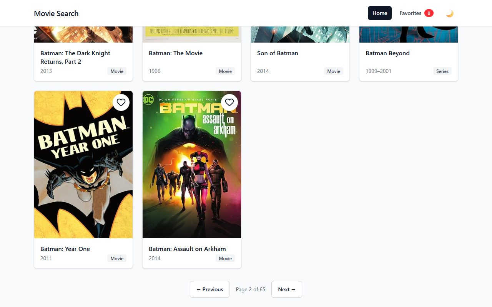

### Type and year filters

The type buttons and year dropdown re-run the current search without retyping it. Changing a filter always returns to page 1. If a filtered search finds nothing, a **Clear filters** button resets them.

| Series only | Movies from 2022 |
| --- | --- |
| 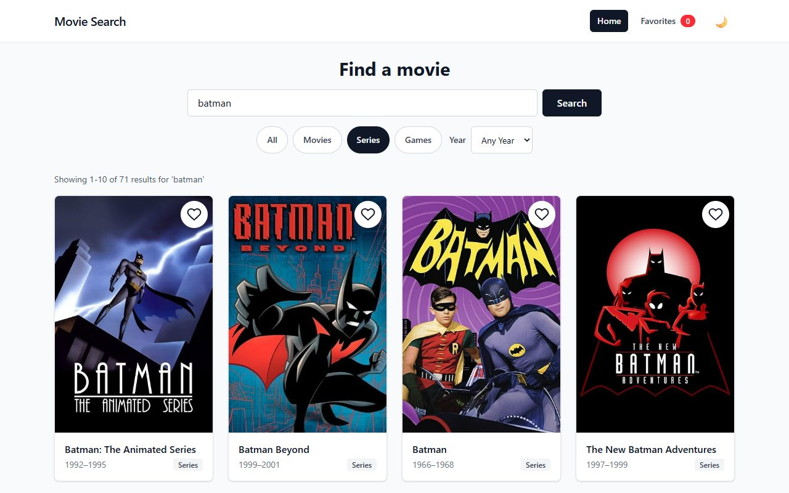 | 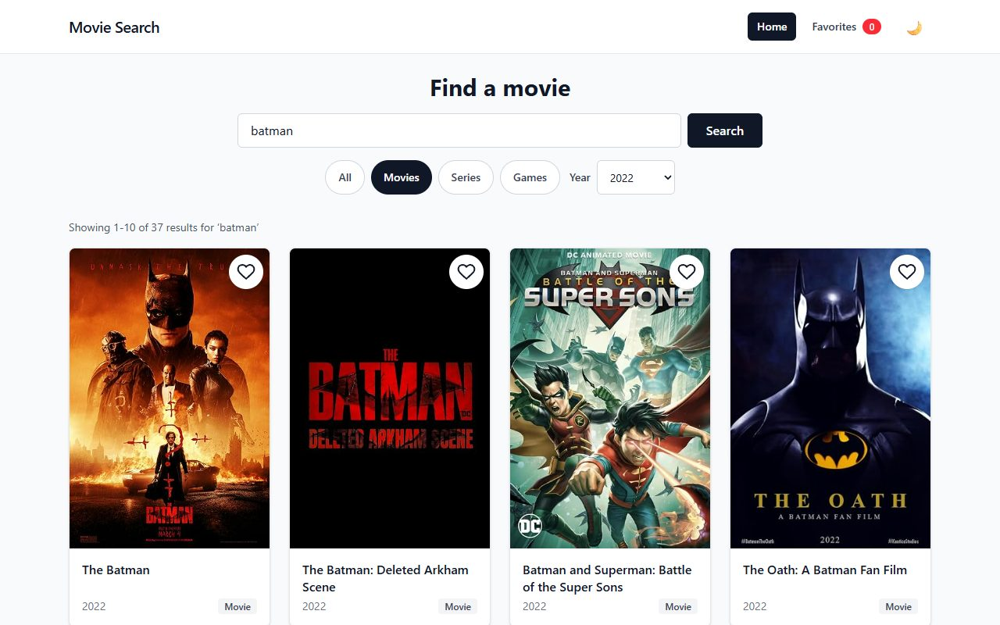 |

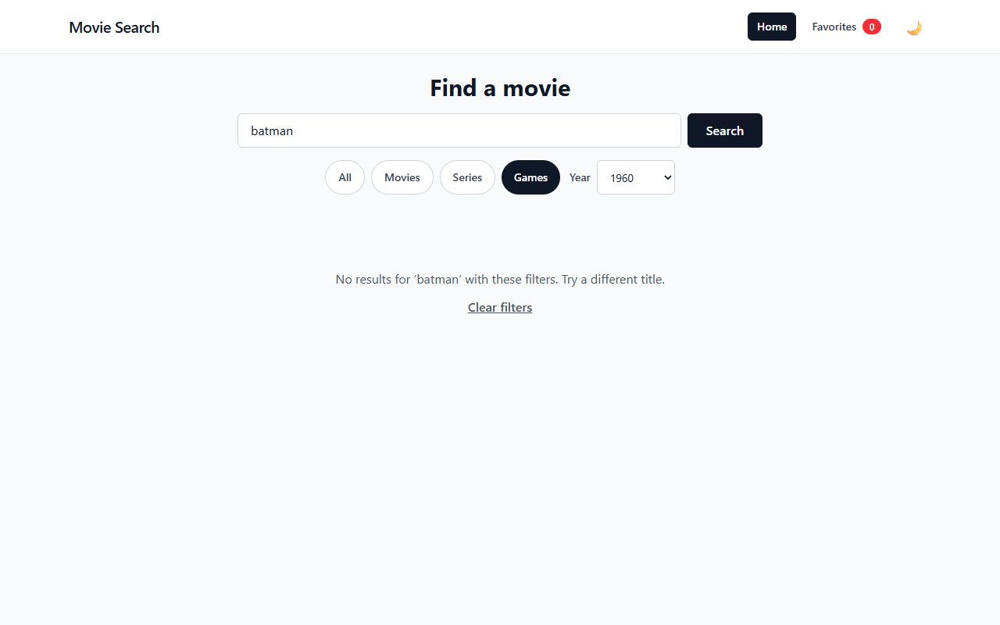

### Vague searches

For very short searches such as `go` or `ss`, OMDb refuses to return a list and answers "Too many results." Instead of showing that as an error, the app looks up the closest matching title for each type (movie, series and game) and shows those, with a hint to type more of the title.

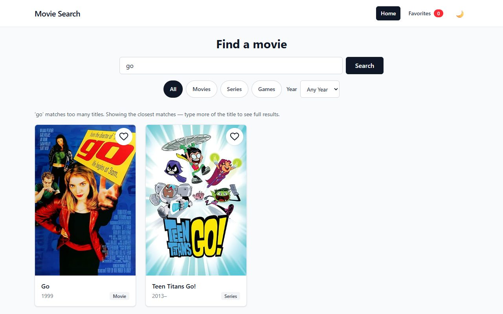

### Search history

The last 10 searches are stored in `localStorage`. Clicking into the search box shows them in a dropdown, filtered by whatever has been typed so far. Clicking a suggestion runs that search. Repeating a search moves it to the top instead of adding a duplicate. <kbd>Esc</kbd> closes the list.

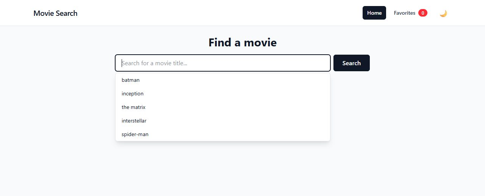

### Favorites

Click the heart on any card or on the details page to save a title. Saved titles show a filled red heart, and the count in the header updates straight away, even across open tabs. The Favorites page lists everything saved. With nothing saved, it shows a prompt and a link back to search.

| Saving from the results | Favorites page |
| --- | --- |
| 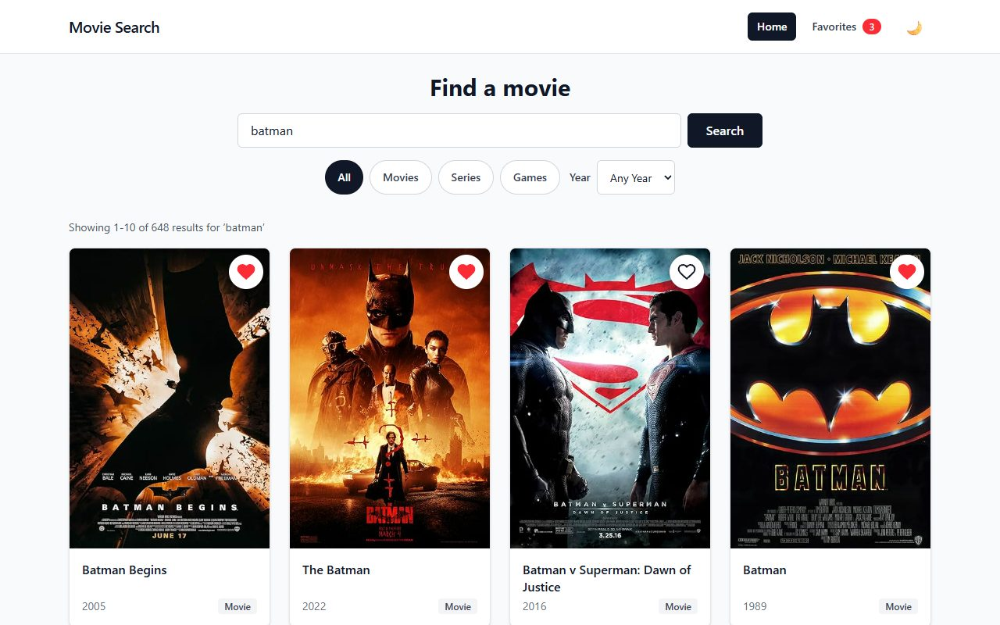 | 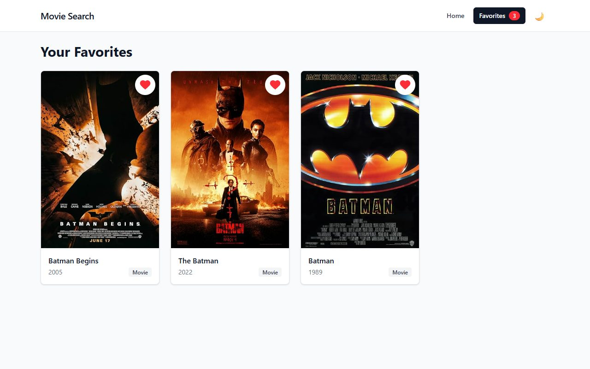 |

### Movie details page

Clicking a card opens `/movie/:id`, which loads the full record (`i=<imdbID>&plot=full`). **Back to Search** returns to the previous results with the filters and page still in place.

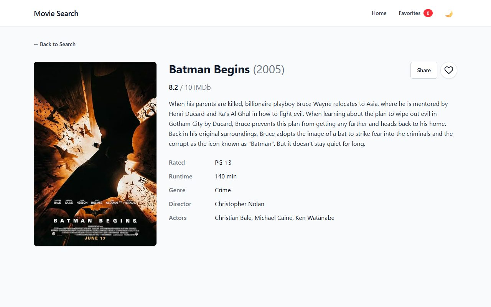

### Share a movie

**Share** copies the current page URL to the clipboard and shows "Link copied!" for two seconds. If the browser blocks clipboard access, it shows "Could not copy link" instead.

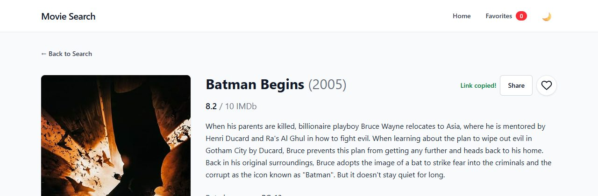

### Loading and error states

A spinner shows while any request is in progress. Unknown movie IDs, empty searches and network failures each have their own message.

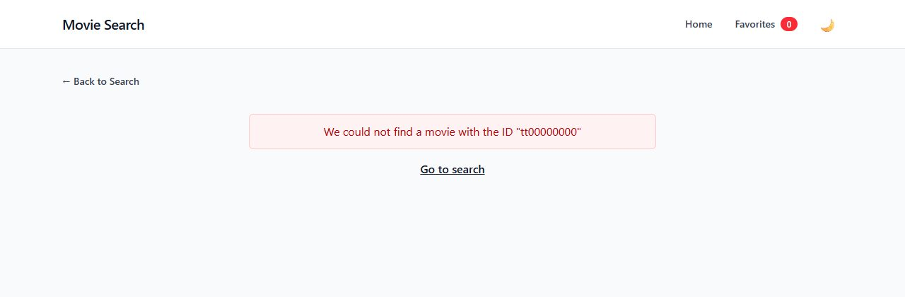

### Dark mode

The moon / sun button in the header switches themes. The choice is saved in `localStorage`. On a first visit the app follows the operating system's theme setting.

| Results | Details |
| --- | --- |
| 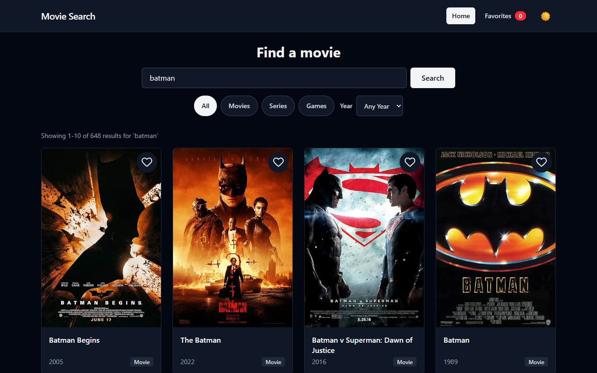 | 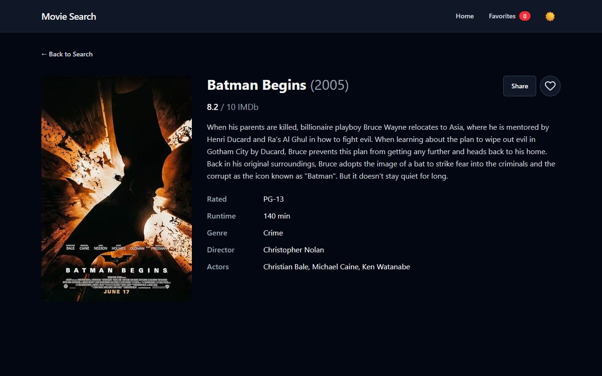 |

### Responsive layout

On narrow screens the search button moves under the input, the filters wrap, and the grid drops to one column. Buttons are at least 44px tall so they are easy to tap.

| Results on a phone | Details on a phone |
| --- | --- |
| 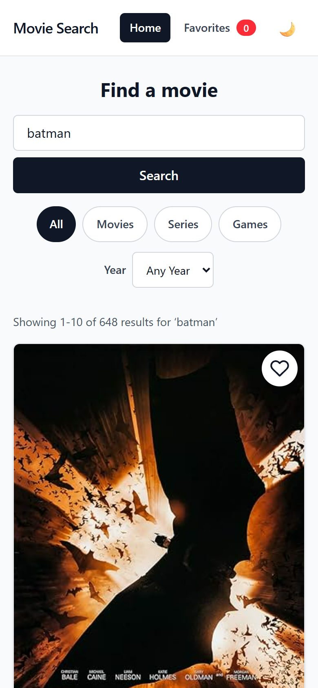 | 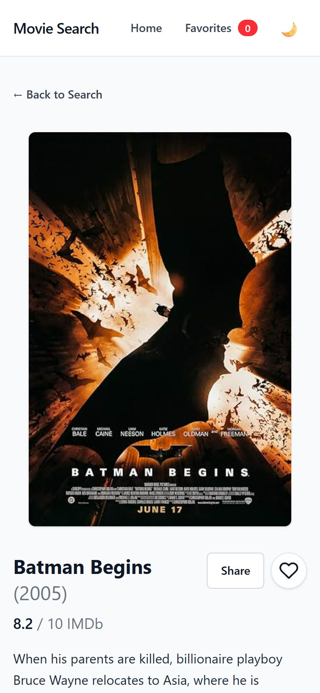 |

## Project structure

```
movie-search-app/
├── index.html              # Also applies the saved theme before React loads, so there is no white flash
├── package.json
├── vite.config.js          # React and Tailwind plugins
├── eslint.config.js
├── .env                    # VITE_OMDB_API_KEY (not committed)
├── docs/
│   └── screenshots/        # Images used in this README
├── public/
│   └── favicon.svg
└── src/
    ├── main.jsx            # React entry point
    ├── App.jsx             # BrowserRouter, header and route definitions
    ├── index.css           # Tailwind import and class-based dark mode variant
    ├── App.css             # Small global tweaks
    ├── components/
    │   ├── Header.jsx          # Logo, nav links, favorites count, theme toggle
    │   ├── SearchBar.jsx       # Search form with the history dropdown
    │   ├── TypeFilter.jsx      # All / Movies / Series / Games buttons
    │   ├── YearFilter.jsx      # Year dropdown
    │   ├── MovieGrid.jsx       # Responsive grid of MovieCards
    │   ├── MovieCard.jsx       # Poster, title, year, type and heart; links to the details page
    │   ├── Poster.jsx          # Poster image with a "No Poster Available" fallback
    │   ├── Pagination.jsx      # Previous / Next buttons and page count
    │   ├── FavoriteButton.jsx  # Heart toggle
    │   ├── ShareButton.jsx     # Copy link button with "Link copied!" message
    │   ├── DetailRow.jsx       # One label / value row on the details page
    │   ├── LoadingSpinner.jsx
    │   └── ErrorMessage.jsx
    ├── hooks/
    │   ├── useFetch.js           # Fetches a URL and returns { data, loading, error }
    │   ├── useClosestMatches.js  # Fallback title lookups for vague searches
    │   ├── useFavorites.js       # Live list of favorites, kept in sync across components and tabs
    │   └── useTheme.js           # Light / dark theme state, saved to localStorage
    ├── pages/
    │   ├── HomePage.jsx          # Search, filters, results and pagination
    │   ├── MovieDetailsPage.jsx
    │   └── FavoritesPage.jsx
    └── utils/
        ├── omdb.js               # Builds OMDb request URLs
        ├── favorites.js          # Read / write favorites in localStorage
        └── searchHistory.js      # Read / write the last 10 searches in localStorage
```

## How it works

- **Search state lives in the URL.** `HomePage` reads `q`, `type`, `y` and `page` with `useSearchParams` and builds the request URL from them. Searching, filtering and paging only change the URL through an `updateParams` helper, and `useFetch` re-runs whenever the URL changes. Because of this, the browser back button, refreshes and shared links all work without extra code.
- **`useFetch(url)`** keeps each response together with the URL it came from, and only returns data that matches the current URL. Old results never flash while new ones load. It cancels the previous request with `AbortController` when the URL changes or the page unmounts. OMDb returns errors as `{ "Response": "False", "Error": "..." }` with a 200 status, so the hook checks `Response` as well as `response.ok`.
- **Vague searches.** When the search returns "Too many results.", `useClosestMatches` calls OMDb's title lookup (`t=`) once per type in parallel and shows whichever titles come back.
- **Favorites** are stored under `movie-favorites` in `localStorage`. Only the fields the cards need (`imdbID`, `Title`, `Year`, `Poster`, `Type`) are saved. Writing fires a custom `favorites-changed` event, and `useFavorites` listens for it (and for the browser's `storage` event), so the header count and every heart update together.
- **Search history** is stored under `search-history`. Suggestions use `onMouseDown` instead of `onClick`, because the input's `blur` would otherwise close the list before the click registers.
- **Dark mode** uses Tailwind 4's `@custom-variant dark (&:where(.dark, .dark *))`, so `dark:` classes apply when `<html>` has the `dark` class. A small script in `index.html` adds that class before the page paints, and `useTheme` keeps it in sync and saves the choice under `theme`.

## Tech stack

- [React 19](https://react.dev/)
- [React Router 7](https://reactrouter.com/) (`react-router-dom`)
- [Vite 8](https://vite.dev/) for the dev server and production build
- [Tailwind CSS 4](https://tailwindcss.com/) via the `@tailwindcss/vite` plugin
- [OMDb API](https://www.omdbapi.com/) for movie data
- ESLint with the React Hooks and React Refresh plugins

## Setup

### Prerequisites

- Node.js 20 or newer (the project was built on Node 24)
- npm 10 or newer
- A free OMDb API key

### 1. Get an OMDb API key

1. Go to <https://www.omdbapi.com/apikey.aspx>, choose the **FREE** plan (1,000 requests a day) and enter your email.
2. Click the activation link in the email OMDb sends you. The key does not work until it is activated.

### 2. Install and configure

This project lives inside the larger `mctaba` repository, so change into its folder first.

```bash
git clone https://github.com/amokim/mctaba.git
cd "mctaba/Week 4/movie-search-app"
npm install
```

Create a file called `.env` in the project folder:

```
VITE_OMDB_API_KEY=your_key_here
```

Vite only exposes variables that start with `VITE_` to the browser. `.env` is listed in `.gitignore`, so the key is not committed. Restart the dev server after changing it.

### 3. Run the app

```bash
npm run dev
```

Vite prints a local URL, normally <http://localhost:5173>. Try `batman`, then switch to **Series**, pick a year, go to page 2, save a few favorites and toggle dark mode.

### Available scripts

| Command | What it does |
| --- | --- |
| `npm run dev` | Start the development server with hot module replacement |
| `npm run build` | Create an optimised production build in `dist/` |
| `npm run preview` | Serve the `dist/` folder locally to check the production build |
| `npm run lint` | Run ESLint over the project |

## Deploying to Vercel

1. Push your latest changes to GitHub.
2. In Vercel, click **Add New → Project** and import `amokim/mctaba`.
3. Set **Root Directory** to `Week 4/movie-search-app`. Vercel detects Vite and fills in `npm run build` and `dist`.
4. Under **Environment Variables**, add `VITE_OMDB_API_KEY` with your key. `.env` is not committed, so without this step every search fails.
5. Click **Deploy**, then paste the URL into the **Live demo** line at the top of this README.

The app uses `BrowserRouter`, so refreshing a page such as `/movie/tt0372784` needs the server to send back `index.html`. Add a `vercel.json` next to `package.json`:

```json
{
  "rewrites": [{ "source": "/(.*)", "destination": "/index.html" }]
}
```

## Troubleshooting

- **Every search shows an error**: check that `.env` contains `VITE_OMDB_API_KEY`, that the key has been activated from the OMDb email, and that the dev server was restarted. On Vercel, check the environment variable and redeploy.
- **"Request limit reached!"**: the free key allows 1,000 requests a day. It resets after 24 hours.
- **"Could not copy link"**: the clipboard API only works on `https://` or `localhost`. Opening the dev server from a phone at `http://192.168.x.x` will not allow it.
- **404 when refreshing a page on Vercel**: add the `vercel.json` shown above.
- **VS Code warns "Unknown at rule @custom-variant"**: this is VS Code's plain CSS checker, not a real error. Install the Tailwind CSS IntelliSense extension, or set `"css.lint.unknownAtRules": "ignore"` in `.vscode/settings.json`.

## Learning goals

- Fetching data from a third-party API with an API key kept in environment variables
- Writing custom hooks (`useFetch`, `useFavorites`, `useTheme`, `useClosestMatches`) to keep components small
- Cancelling requests with `AbortController` and ignoring responses for an old URL
- Keeping search, filter and page state in the URL with `useSearchParams`
- Dynamic routes with `useParams` and navigating in code with `useNavigate`
- Persisting favorites, search history and theme in `localStorage`, and syncing state with custom events
- Handling loading, empty and error states, including API errors returned with a 200 status
- Building responsive layouts and a class-based dark mode with Tailwind CSS 4
- Using browser APIs such as the Clipboard API
