# Library Books: React Frontend and Express API (Week 5, Day 4)

A small library app in two parts:

- **`backend/`**: a REST API built with Express 5. Besides creating, reading, updating and deleting books, it lets you borrow and return them, and the list route supports filtering, search, sorting and pagination.
- **`week-5-day-4-frontend/`**: a React app, built with Vite, that lists the books, searches them as you type, adds new books and deletes books after a confirmation. It has a light and a dark theme.

The API keeps its data in memory, so it resets to the original eight books every time the server restarts.

## Getting started

Requirements: Node.js 18 or later. Start the API first, because the frontend loads its books from `http://localhost:3000/api/books` (set in `week-5-day-4-frontend/src/api.js`).

```bash
# terminal 1 - the API, runs at http://localhost:3000
cd backend
npm install
npm start

# terminal 2 - the frontend
cd week-5-day-4-frontend
npm install
npm run dev
```

Then open the address Vite prints, usually `http://localhost:5173`.

## Project structure

```
Week-5-day-4-assignment/
├── README.md                         # this file
├── backend/
│   ├── server.js                     # Express app, in-memory data, all routes and error handlers
│   ├── screenshots/                  # curl output for each endpoint
│   └── package.json
└── week-5-day-4-frontend/
    ├── src/
    │   ├── main.jsx                  # entry point, renders <App />
    │   ├── App.jsx                   # state, fetching, search, add, delete and theme logic
    │   ├── App.css                   # component styles
    │   ├── index.css                 # theme colours, spacing and base styles
    │   ├── api.js                    # API_URL
    │   └── components/
    │       ├── AddBookForm.jsx       # add a book form
    │       ├── BookCard.jsx          # one book card with its Delete button
    │       ├── ConfirmDialog.jsx     # themed confirmation dialog
    │       ├── SearchBar.jsx         # search input
    │       └── ThemeToggle.jsx       # light/dark button
    ├── screenshots/                  # app screenshots
    └── package.json
```

All the API's routes and validation live in `backend/server.js`. The backend used to have empty `routes/books.js` and `middleware/validate.js` placeholder files that nothing imported. They have been removed, which doesn't change how the server runs.

## Frontend

### Book list, light and dark themes

The books show as cards with their author, genre and a status badge: green for available, red with the borrower's name for borrowed. The theme button in the top right switches between light and dark. Your choice is saved in `localStorage`, and on a first visit the app follows your operating system's setting.

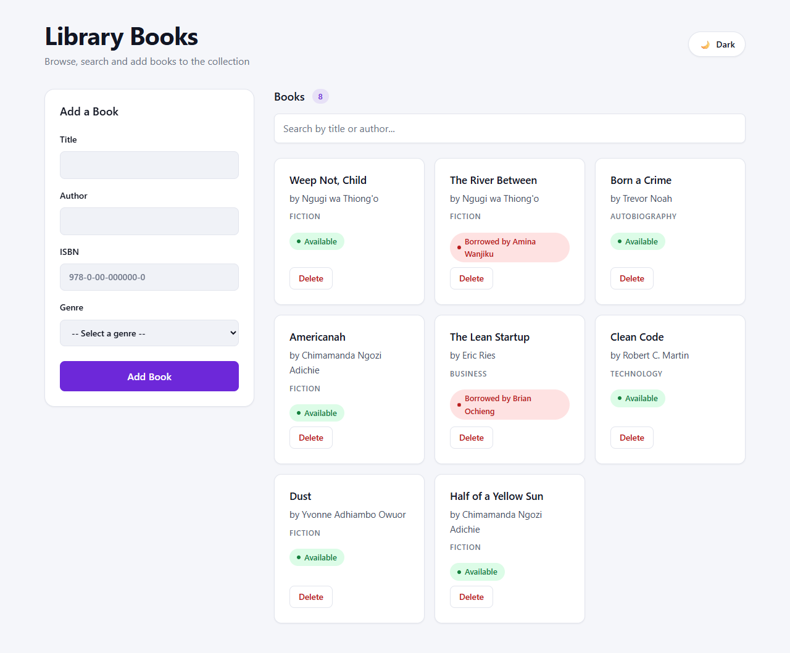

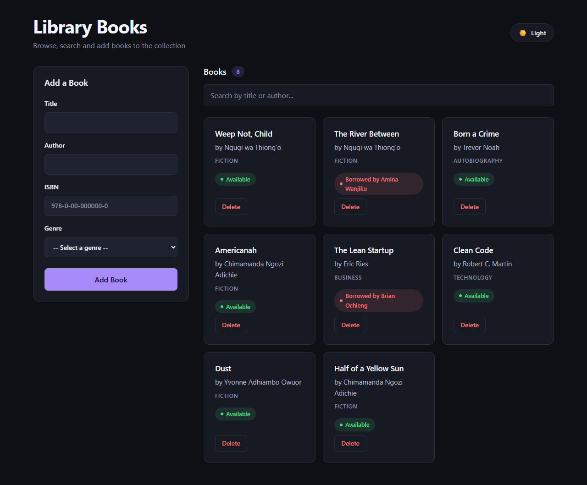

### Search

The search box filters by title or author as you type. The app waits 300 ms after the last key press before calling the API, and cancels a request that is still running when a new one starts, so older results never replace newer ones.

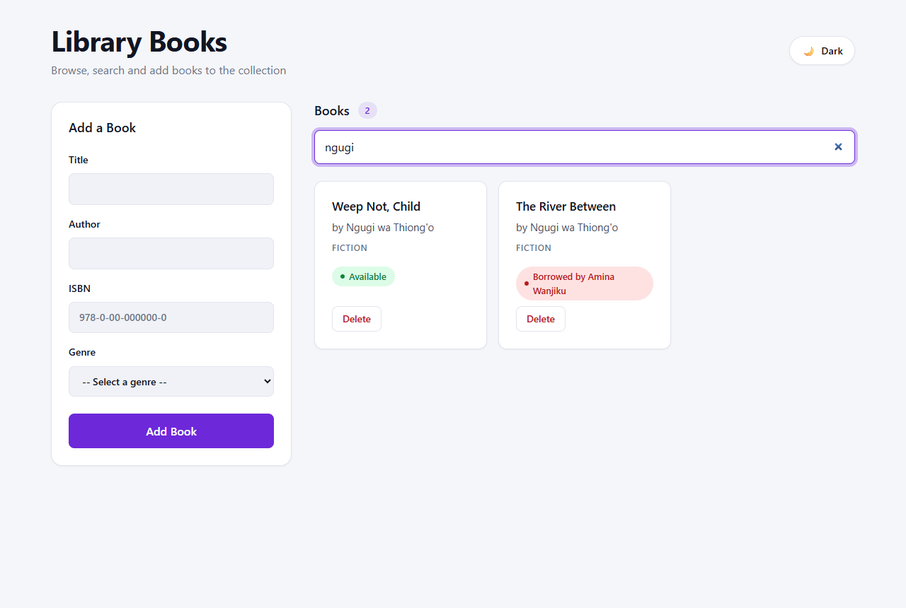

### Add a book

The form sends the book to `POST /api/books`. Errors from the API, such as an invalid or duplicate ISBN, are shown under the form:

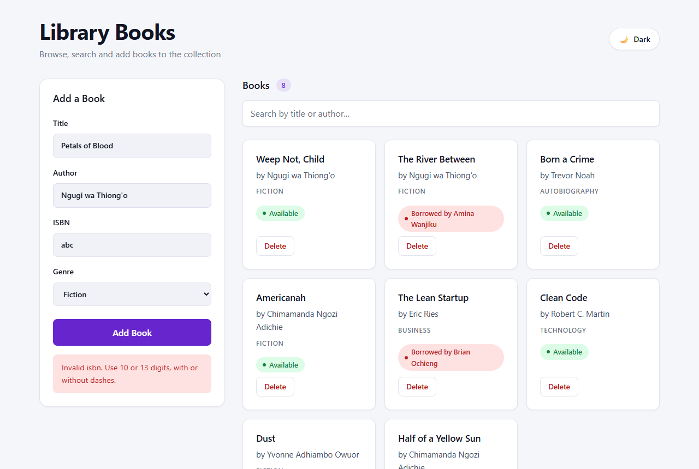

When the book is saved, it is added to the end of the list and a message appears in the top right corner:

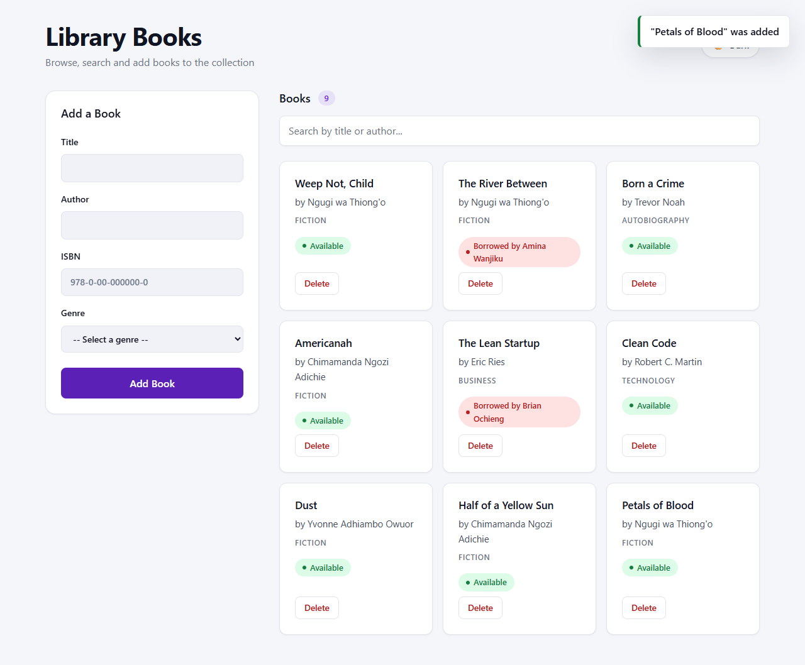

### Delete a book

Clicking **Delete** on a card opens a confirmation dialog. It uses the page's theme, has rounded corners, and closes without deleting if you click **Cancel**, press **Esc**, or click outside it.

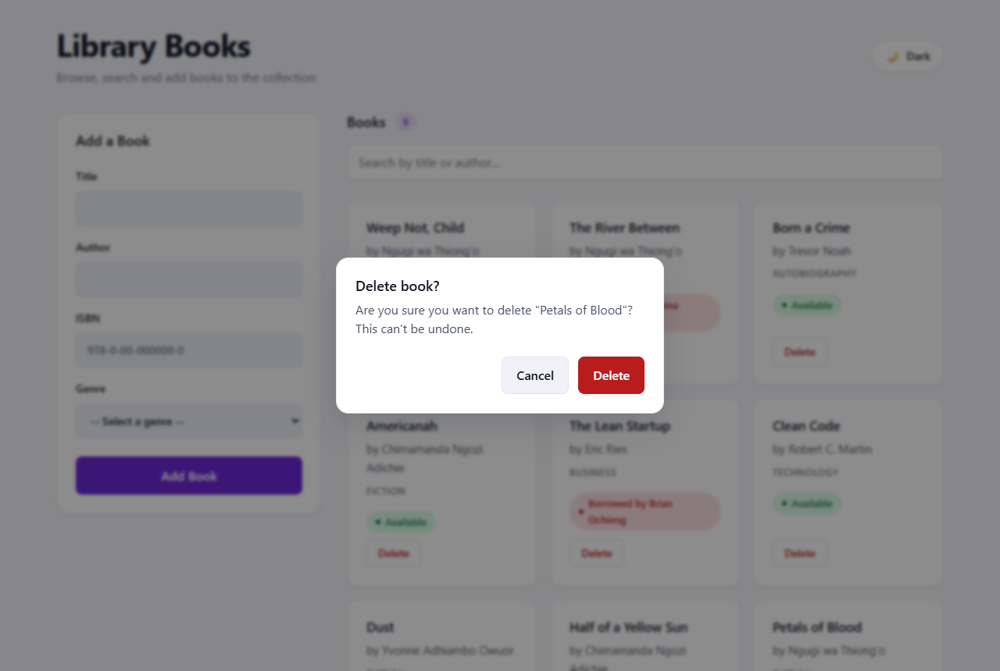

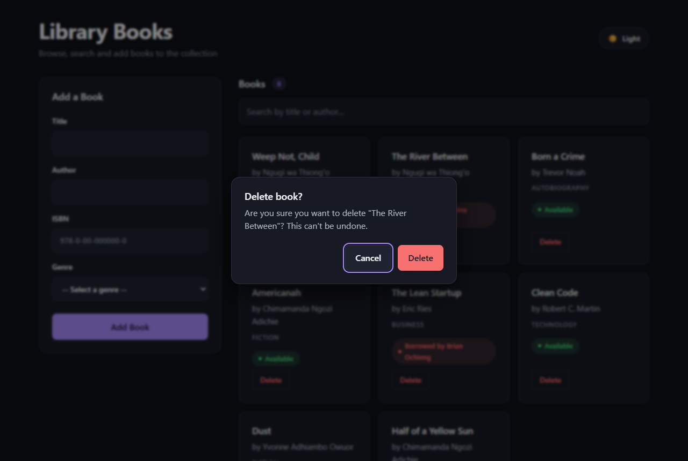

Deleting is **optimistic**: the book disappears from the list right away, and the `DELETE` request is sent afterwards. If the API succeeds, the book stays removed:

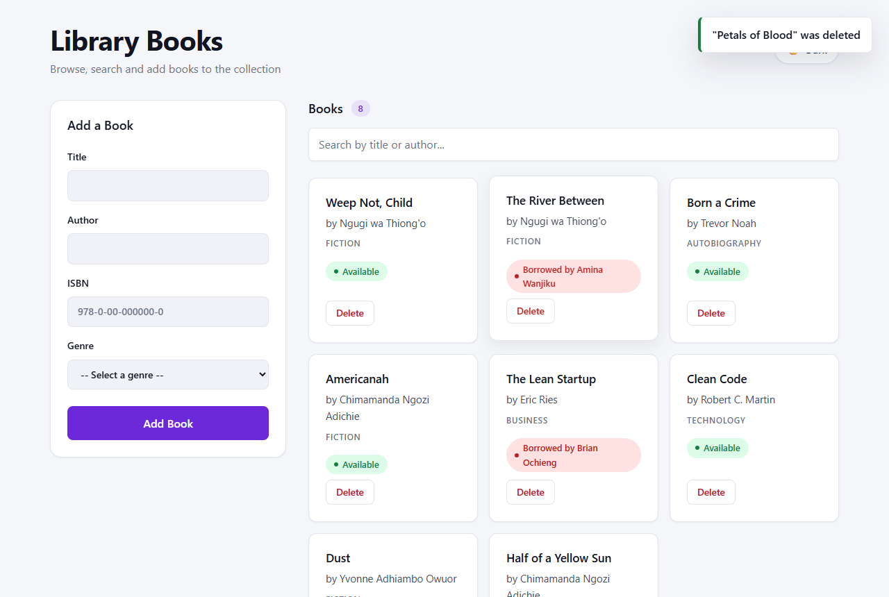

If the API refuses, for example because the book is borrowed, the book is put back in the list and the API's error message is shown:

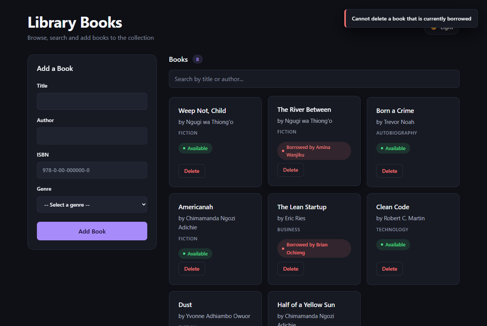

### Phone layout

On narrow screens the form and the book list stack into one column:

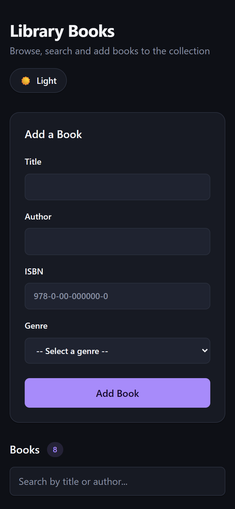

### Scripts

| Command | What it does |
| --- | --- |
| `npm run dev` | Starts the dev server with hot reload |
| `npm run build` | Builds the app into `dist/` |
| `npm run preview` | Serves the built app |
| `npm run lint` | Checks the code with Oxlint |

Run these from `week-5-day-4-frontend/`.

## Books API

### Endpoints

| Method | Route | What it does | Success status |
| --- | --- | --- | --- |
| `GET` | `/` | Welcome message and a list of endpoints | 200 |
| `GET` | `/api/books` | All books. Supports filtering, search, sorting and pagination | 200 |
| `GET` | `/api/books/:id` | One book by ID | 200 |
| `POST` | `/api/books` | Adds a book | 201 |
| `PUT` | `/api/books/:id` | Replaces a book (every field required) | 200 |
| `DELETE` | `/api/books/:id` | Deletes a book and returns it. Borrowed books can't be deleted | 200 |
| `POST` | `/api/books/:id/borrow` | Borrows a book | 200 |
| `POST` | `/api/books/:id/return` | Returns a borrowed book | 200 |

#### Query options for `GET /api/books`

| Parameter | Example | Behaviour |
| --- | --- | --- |
| `genre` | `?genre=fiction` | Exact match on genre, ignoring upper and lower case. No matches returns an empty list |
| `available` | `?available=true` | `true` or `false` only. Any other value returns 400 |
| `search` | `?search=ngugi` | Books whose title or author contains the text, ignoring case. A search of only spaces is ignored. No matches returns an empty list |
| `sort` | `?sort=title` | `title` or `author` only. Any other value returns 400 |
| `order` | `?order=desc` | `asc` (default) or `desc`. Only used with `sort` |
| `page` | `?page=2` | Page number, default 1. Must be a whole number of at least 1 |
| `limit` | `?limit=3` | Books per page, default 10. Must be a whole number from 1 to 100 |

Each option can be given only once. A repeated option such as `?genre=fiction&genre=business` returns 400.

The options can be combined, for example `?genre=fiction&available=true&sort=title&page=1&limit=2`. Filters and search run first, then sorting, then pagination. Every response from this route includes a `pagination` object:

```json
"pagination": { "page": 1, "limit": 3, "total": 8, "totalPages": 3 }
```

`count` is the number of books on the current page, and `total` is the number of books that matched before paging.

#### Validation

| Route | Rule |
| --- | --- |
| `POST /api/books` | `title`, `author`, `isbn` and `genre` are required, non-empty strings |
| `PUT /api/books/:id` | Same as `POST`, plus `available` (boolean) and `borrowedBy` are required |
| `POST` and `PUT` | `isbn` must contain only digits and dashes, with exactly 10 or 13 digits. Dashes are optional. It must not already belong to another book, and dashes are ignored when checking, so `9780140186502` and `978-0-14-018650-2` count as the same ISBN |
| `PUT` | If `available` is `true`, `borrowedBy` must be `null`. If `available` is `false`, `borrowedBy` must be a name |
| `POST /api/books/:id/borrow` | `borrower` is a required, non-empty string |

#### Status codes

| Status | When |
| --- | --- |
| 400 | Missing or invalid fields, an ID that isn't a positive whole number, an invalid or repeated query option, a request body that isn't valid JSON, borrowing a book that is already borrowed, returning a book that isn't borrowed, or deleting a borrowed book |
| 404 | No book has the given ID, or the route doesn't exist |
| 409 | The ISBN already belongs to another book |
| 500 | An unexpected server error |

Every response, including errors, is JSON in the form `{ "success": false, "error": "..." }`, so a client can always call `res.json()`.

### Testing with curl

The commands below are for Git Bash, macOS or Linux. In Windows cmd, put the JSON body in double quotes and escape the inner quotes, for example `-d "{\"borrower\":\"Wanjiku\"}"`. The responses come from a fresh server and were run in the order shown, so the book added by `POST` gets ID 9 and is deleted at the end.

#### 1. Welcome route

```bash
curl http://localhost:3000/
```

```json
{
  "message": "Welcome to Books API",
  "version": "1.0.0",
  "endpoints": {
    "listBooks": "GET /api/books?genre=&available=&search=&sort=title|author&order=asc|desc&page=&limit=",
    "getBook": "GET /api/books/:id",
    "createBook": "POST /api/books",
    "updateBook": "PUT /api/books/:id",
    "deleteBook": "DELETE /api/books/:id",
    "borrowBook": "POST /api/books/:id/borrow",
    "returnBook": "POST /api/books/:id/return"
  }
}
```

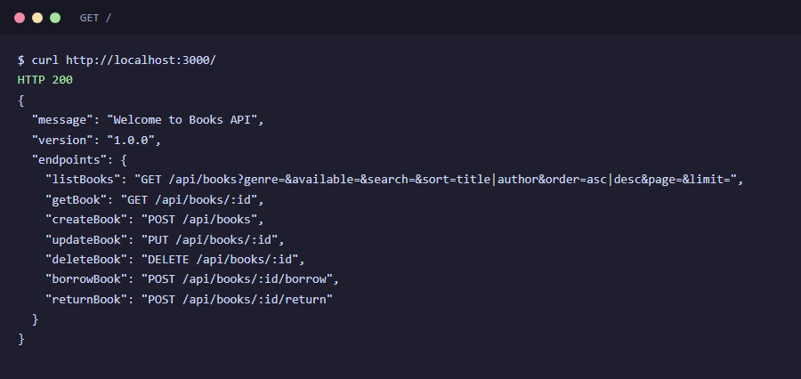

#### 2. Get all books

```bash
curl http://localhost:3000/api/books
```

```json
{
  "success": true,
  "count": 8,
  "data": [
    { "id": 1, "title": "Weep Not, Child", "author": "Ngugi wa Thiong'o", "isbn": "978-0-14-018650-2", "genre": "fiction", "available": true, "borrowedBy": null },
    { "id": 2, "title": "The River Between", "author": "Ngugi wa Thiong'o", "isbn": "978-0-14-018651-9", "genre": "fiction", "available": false, "borrowedBy": "Amina Wanjiku" },
    { "id": 3, "title": "Born a Crime", "author": "Trevor Noah", "isbn": "978-0-399-59043-2", "genre": "autobiography", "available": true, "borrowedBy": null },
    { "id": 4, "title": "Americanah", "author": "Chimamanda Ngozi Adichie", "isbn": "978-0-307-45592-8", "genre": "fiction", "available": true, "borrowedBy": null },
    { "id": 5, "title": "The Lean Startup", "author": "Eric Ries", "isbn": "978-0-307-88789-4", "genre": "business", "available": false, "borrowedBy": "Brian Ochieng" },
    { "id": 6, "title": "Clean Code", "author": "Robert C. Martin", "isbn": "978-0-13-235088-4", "genre": "technology", "available": true, "borrowedBy": null },
    { "id": 7, "title": "Dust", "author": "Yvonne Adhiambo Owuor", "isbn": "978-1-78470-045-2", "genre": "fiction", "available": true, "borrowedBy": null },
    { "id": 8, "title": "Half of a Yellow Sun", "author": "Chimamanda Ngozi Adichie", "isbn": "978-1-4000-9520-3", "genre": "fiction", "available": true, "borrowedBy": null }
  ],
  "pagination": {
    "page": 1,
    "limit": 10,
    "total": 8,
    "totalPages": 1
  }
}
```

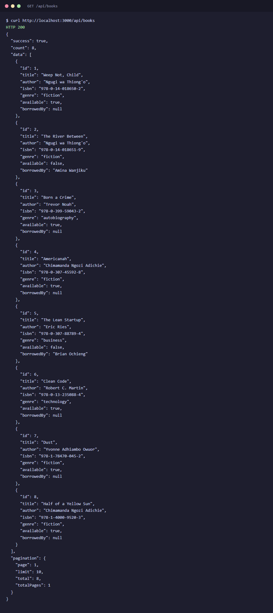

#### 3. Filter by genre

```bash
curl 'http://localhost:3000/api/books?genre=fiction'
```

```json
{
  "success": true,
  "count": 5,
  "data": [
    { "id": 1, "title": "Weep Not, Child", "author": "Ngugi wa Thiong'o", "isbn": "978-0-14-018650-2", "genre": "fiction", "available": true, "borrowedBy": null },
    { "id": 2, "title": "The River Between", "author": "Ngugi wa Thiong'o", "isbn": "978-0-14-018651-9", "genre": "fiction", "available": false, "borrowedBy": "Amina Wanjiku" },
    { "id": 4, "title": "Americanah", "author": "Chimamanda Ngozi Adichie", "isbn": "978-0-307-45592-8", "genre": "fiction", "available": true, "borrowedBy": null },
    { "id": 7, "title": "Dust", "author": "Yvonne Adhiambo Owuor", "isbn": "978-1-78470-045-2", "genre": "fiction", "available": true, "borrowedBy": null },
    { "id": 8, "title": "Half of a Yellow Sun", "author": "Chimamanda Ngozi Adichie", "isbn": "978-1-4000-9520-3", "genre": "fiction", "available": true, "borrowedBy": null }
  ],
  "pagination": {
    "page": 1,
    "limit": 10,
    "total": 5,
    "totalPages": 1
  }
}
```

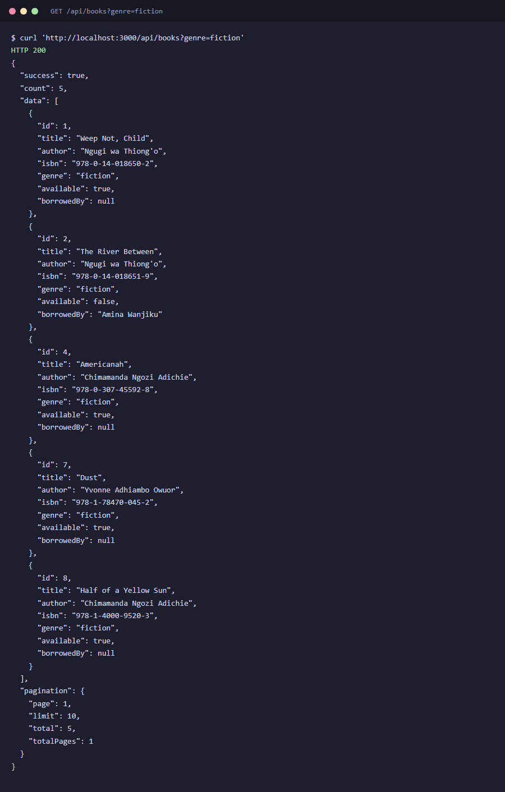

A genre with no books returns **200** with an empty list:

```bash
curl 'http://localhost:3000/api/books?genre=poetry'
```

```json
{
  "success": true,
  "count": 0,
  "data": [],
  "pagination": {
    "page": 1,
    "limit": 10,
    "total": 0,
    "totalPages": 0
  }
}
```

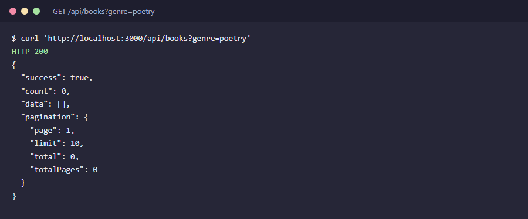

#### 4. Filter by availability

```bash
curl 'http://localhost:3000/api/books?available=true'
```

```json
{
  "success": true,
  "count": 6,
  "data": [
    { "id": 1, "title": "Weep Not, Child", "author": "Ngugi wa Thiong'o", "isbn": "978-0-14-018650-2", "genre": "fiction", "available": true, "borrowedBy": null },
    { "id": 3, "title": "Born a Crime", "author": "Trevor Noah", "isbn": "978-0-399-59043-2", "genre": "autobiography", "available": true, "borrowedBy": null },
    { "id": 4, "title": "Americanah", "author": "Chimamanda Ngozi Adichie", "isbn": "978-0-307-45592-8", "genre": "fiction", "available": true, "borrowedBy": null },
    { "id": 6, "title": "Clean Code", "author": "Robert C. Martin", "isbn": "978-0-13-235088-4", "genre": "technology", "available": true, "borrowedBy": null },
    { "id": 7, "title": "Dust", "author": "Yvonne Adhiambo Owuor", "isbn": "978-1-78470-045-2", "genre": "fiction", "available": true, "borrowedBy": null },
    { "id": 8, "title": "Half of a Yellow Sun", "author": "Chimamanda Ngozi Adichie", "isbn": "978-1-4000-9520-3", "genre": "fiction", "available": true, "borrowedBy": null }
  ],
  "pagination": {
    "page": 1,
    "limit": 10,
    "total": 6,
    "totalPages": 1
  }
}
```

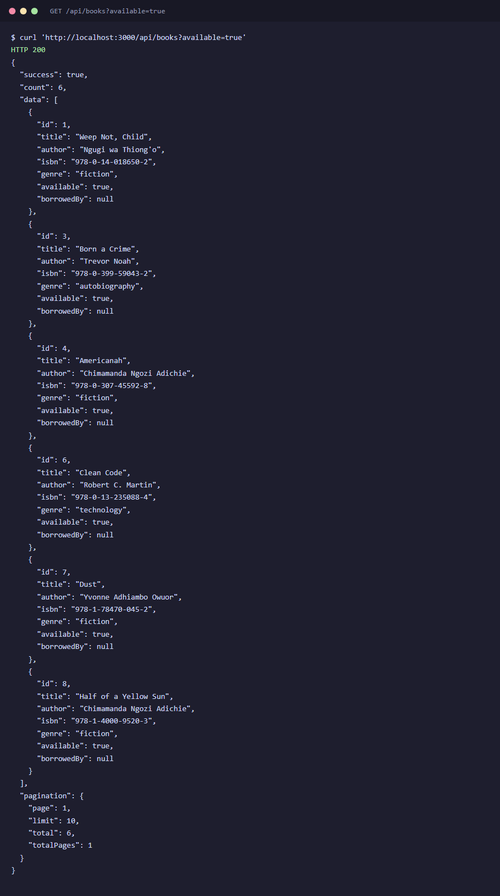

A value other than `true` or `false` returns **400**:

```bash
curl 'http://localhost:3000/api/books?available=maybe'
```

```json
{
  "success": false,
  "error": "Available filter can be set as true or false only."
}
```

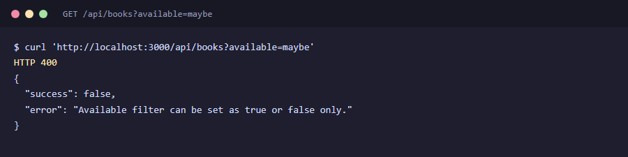

#### 5. Search by title or author

```bash
curl 'http://localhost:3000/api/books?search=ngugi'
```

```json
{
  "success": true,
  "count": 2,
  "data": [
    { "id": 1, "title": "Weep Not, Child", "author": "Ngugi wa Thiong'o", "isbn": "978-0-14-018650-2", "genre": "fiction", "available": true, "borrowedBy": null },
    { "id": 2, "title": "The River Between", "author": "Ngugi wa Thiong'o", "isbn": "978-0-14-018651-9", "genre": "fiction", "available": false, "borrowedBy": "Amina Wanjiku" }
  ],
  "pagination": {
    "page": 1,
    "limit": 10,
    "total": 2,
    "totalPages": 1
  }
}
```

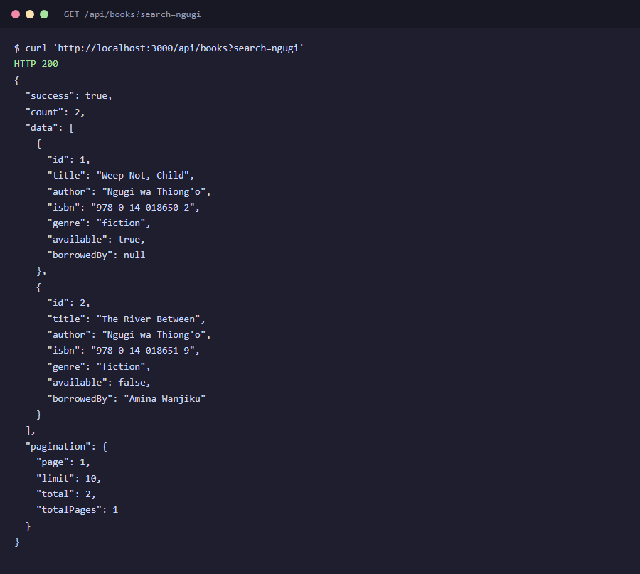

A search with no matches returns **200** with an empty list:

```bash
curl 'http://localhost:3000/api/books?search=xyz'
```

```json
{
  "success": true,
  "count": 0,
  "data": [],
  "pagination": {
    "page": 1,
    "limit": 10,
    "total": 0,
    "totalPages": 0
  }
}
```

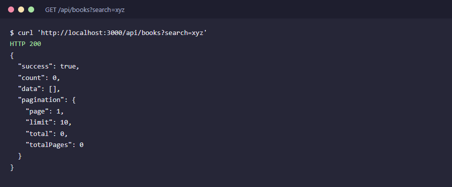

#### 6. Pagination

Page 1 with 3 books per page:

```bash
curl 'http://localhost:3000/api/books?page=1&limit=3'
```

```json
{
  "success": true,
  "count": 3,
  "data": [
    { "id": 1, "title": "Weep Not, Child", "author": "Ngugi wa Thiong'o", "isbn": "978-0-14-018650-2", "genre": "fiction", "available": true, "borrowedBy": null },
    { "id": 2, "title": "The River Between", "author": "Ngugi wa Thiong'o", "isbn": "978-0-14-018651-9", "genre": "fiction", "available": false, "borrowedBy": "Amina Wanjiku" },
    { "id": 3, "title": "Born a Crime", "author": "Trevor Noah", "isbn": "978-0-399-59043-2", "genre": "autobiography", "available": true, "borrowedBy": null }
  ],
  "pagination": {
    "page": 1,
    "limit": 3,
    "total": 8,
    "totalPages": 3
  }
}
```

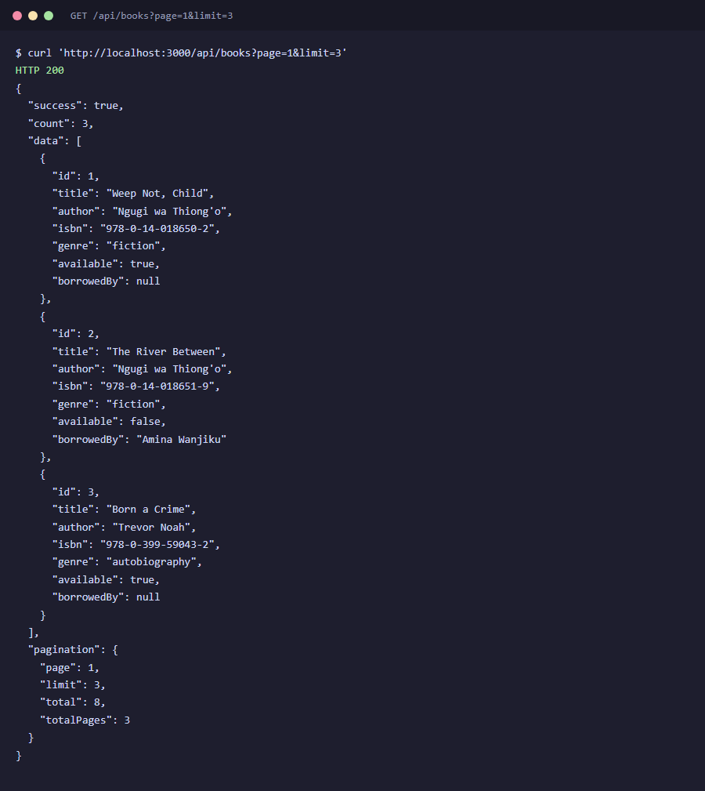

Page 2 skips the first 3 books:

```bash
curl 'http://localhost:3000/api/books?page=2&limit=3'
```

```json
{
  "success": true,
  "count": 3,
  "data": [
    { "id": 4, "title": "Americanah", "author": "Chimamanda Ngozi Adichie", "isbn": "978-0-307-45592-8", "genre": "fiction", "available": true, "borrowedBy": null },
    { "id": 5, "title": "The Lean Startup", "author": "Eric Ries", "isbn": "978-0-307-88789-4", "genre": "business", "available": false, "borrowedBy": "Brian Ochieng" },
    { "id": 6, "title": "Clean Code", "author": "Robert C. Martin", "isbn": "978-0-13-235088-4", "genre": "technology", "available": true, "borrowedBy": null }
  ],
  "pagination": {
    "page": 2,
    "limit": 3,
    "total": 8,
    "totalPages": 3
  }
}
```

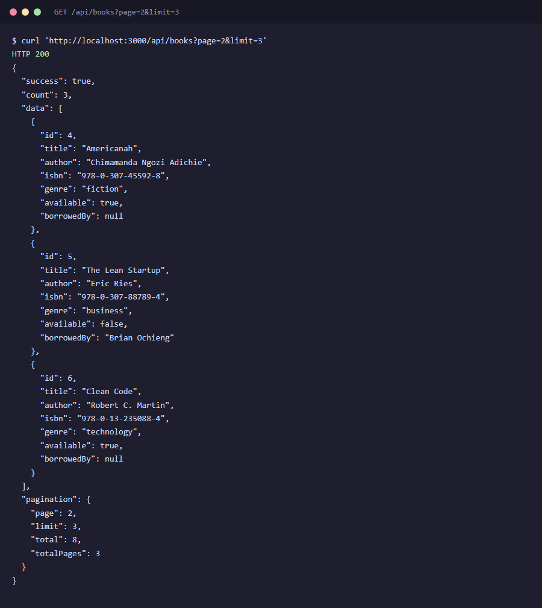

A page or limit that isn't a positive whole number returns **400**:

```bash
curl 'http://localhost:3000/api/books?page=0&limit=3'
```

```json
{
  "success": false,
  "error": "Page and limit must be positive whole numbers."
}
```

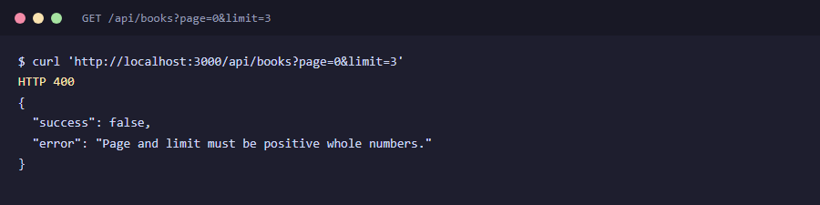

A limit above 100 returns **400**:

```bash
curl 'http://localhost:3000/api/books?limit=500'
```

```json
{
  "success": false,
  "error": "Limit can be at most 100."
}
```

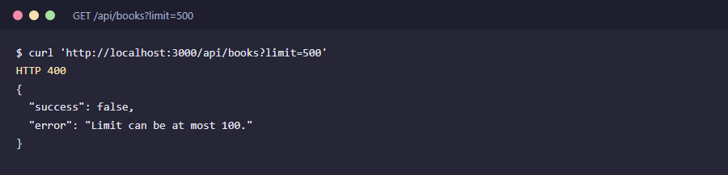

#### 7. Sorting

By title, A to Z:

```bash
curl 'http://localhost:3000/api/books?sort=title&order=asc'
```

```json
{
  "success": true,
  "count": 8,
  "data": [
    { "id": 4, "title": "Americanah", "author": "Chimamanda Ngozi Adichie", "isbn": "978-0-307-45592-8", "genre": "fiction", "available": true, "borrowedBy": null },
    { "id": 3, "title": "Born a Crime", "author": "Trevor Noah", "isbn": "978-0-399-59043-2", "genre": "autobiography", "available": true, "borrowedBy": null },
    { "id": 6, "title": "Clean Code", "author": "Robert C. Martin", "isbn": "978-0-13-235088-4", "genre": "technology", "available": true, "borrowedBy": null },
    { "id": 7, "title": "Dust", "author": "Yvonne Adhiambo Owuor", "isbn": "978-1-78470-045-2", "genre": "fiction", "available": true, "borrowedBy": null },
    { "id": 8, "title": "Half of a Yellow Sun", "author": "Chimamanda Ngozi Adichie", "isbn": "978-1-4000-9520-3", "genre": "fiction", "available": true, "borrowedBy": null },
    { "id": 5, "title": "The Lean Startup", "author": "Eric Ries", "isbn": "978-0-307-88789-4", "genre": "business", "available": false, "borrowedBy": "Brian Ochieng" },
    { "id": 2, "title": "The River Between", "author": "Ngugi wa Thiong'o", "isbn": "978-0-14-018651-9", "genre": "fiction", "available": false, "borrowedBy": "Amina Wanjiku" },
    { "id": 1, "title": "Weep Not, Child", "author": "Ngugi wa Thiong'o", "isbn": "978-0-14-018650-2", "genre": "fiction", "available": true, "borrowedBy": null }
  ],
  "pagination": {
    "page": 1,
    "limit": 10,
    "total": 8,
    "totalPages": 1
  }
}
```

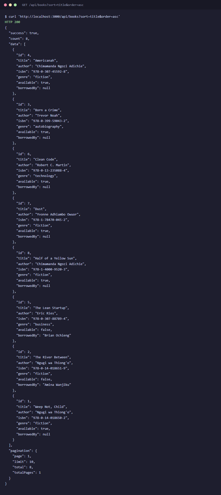

By author, Z to A:

```bash
curl 'http://localhost:3000/api/books?sort=author&order=desc'
```

```json
{
  "success": true,
  "count": 8,
  "data": [
    { "id": 7, "title": "Dust", "author": "Yvonne Adhiambo Owuor", "isbn": "978-1-78470-045-2", "genre": "fiction", "available": true, "borrowedBy": null },
    { "id": 3, "title": "Born a Crime", "author": "Trevor Noah", "isbn": "978-0-399-59043-2", "genre": "autobiography", "available": true, "borrowedBy": null },
    { "id": 6, "title": "Clean Code", "author": "Robert C. Martin", "isbn": "978-0-13-235088-4", "genre": "technology", "available": true, "borrowedBy": null },
    { "id": 2, "title": "The River Between", "author": "Ngugi wa Thiong'o", "isbn": "978-0-14-018651-9", "genre": "fiction", "available": false, "borrowedBy": "Amina Wanjiku" },
    { "id": 1, "title": "Weep Not, Child", "author": "Ngugi wa Thiong'o", "isbn": "978-0-14-018650-2", "genre": "fiction", "available": true, "borrowedBy": null },
    { "id": 5, "title": "The Lean Startup", "author": "Eric Ries", "isbn": "978-0-307-88789-4", "genre": "business", "available": false, "borrowedBy": "Brian Ochieng" },
    { "id": 8, "title": "Half of a Yellow Sun", "author": "Chimamanda Ngozi Adichie", "isbn": "978-1-4000-9520-3", "genre": "fiction", "available": true, "borrowedBy": null },
    { "id": 4, "title": "Americanah", "author": "Chimamanda Ngozi Adichie", "isbn": "978-0-307-45592-8", "genre": "fiction", "available": true, "borrowedBy": null }
  ],
  "pagination": {
    "page": 1,
    "limit": 10,
    "total": 8,
    "totalPages": 1
  }
}
```

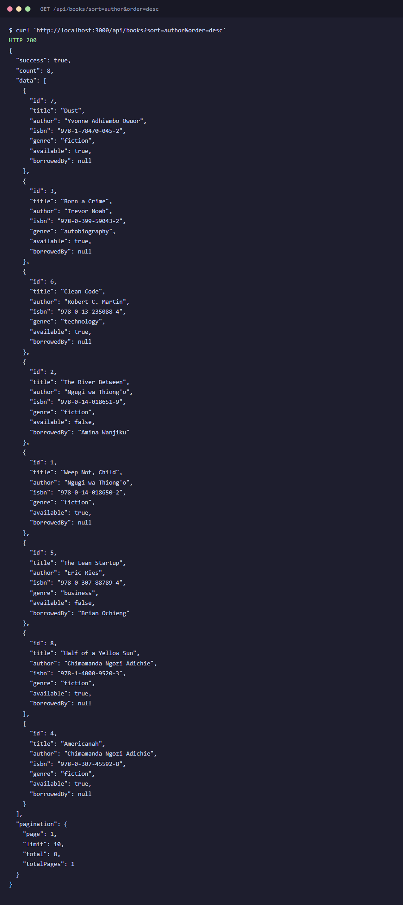

Sorting by any field other than `title` or `author` returns **400**:

```bash
curl 'http://localhost:3000/api/books?sort=price'
```

```json
{
  "success": false,
  "error": "Sort can be set as title or author only."
}
```

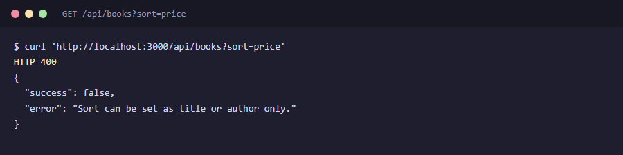

#### 8. Get one book

```bash
curl http://localhost:3000/api/books/1
```

```json
{
  "success": true,
  "data": {
    "id": 1,
    "title": "Weep Not, Child",
    "author": "Ngugi wa Thiong'o",
    "isbn": "978-0-14-018650-2",
    "genre": "fiction",
    "available": true,
    "borrowedBy": null
  }
}
```

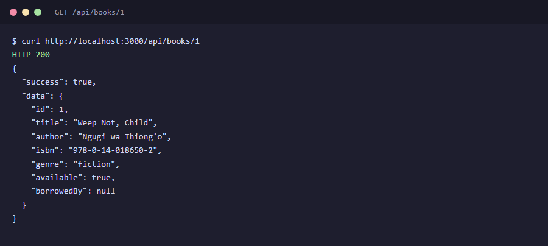

An ID that doesn't exist returns **404**:

```bash
curl http://localhost:3000/api/books/99
```

```json
{
  "success": false,
  "error": "No book with id of 99."
}
```

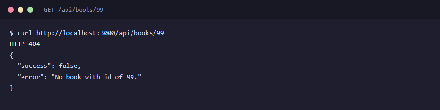

An ID that isn't a positive whole number returns **400**:

```bash
curl http://localhost:3000/api/books/abc
```

```json
{
  "success": false,
  "error": "'abc' is not a valid book id. Use a positive whole number."
}
```

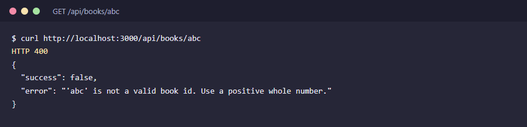

IDs must be written as plain digits, so forms that JavaScript would read as a number, such as `0x2`, `1e0` or `2.0`, also return **400**. The same check applies to every route with `:id`:

```bash
curl http://localhost:3000/api/books/0x2
```

```json
{
  "success": false,
  "error": "'0x2' is not a valid book id. Use a positive whole number."
}
```


#### 9. Add a book

Returns **201 Created**. New books start as available with no borrower, and the genre is saved in lower case:

```bash
curl -X POST http://localhost:3000/api/books \
  -H 'Content-Type: application/json' \
  -d '{"title":"Petals of Blood","author":"Ngugi wa Thiong'\''o","isbn":"978-0-14-118702-7","genre":"fiction"}'
```

```json
{
  "success": true,
  "data": {
    "id": 9,
    "title": "Petals of Blood",
    "author": "Ngugi wa Thiong'o",
    "isbn": "978-0-14-118702-7",
    "genre": "fiction",
    "available": true,
    "borrowedBy": null
  }
}
```

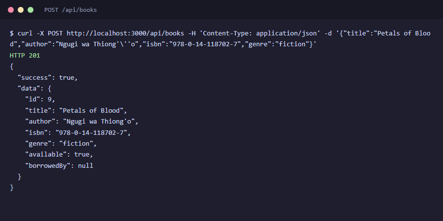

Missing fields return **400**, listing every field that is missing:

```bash
curl -X POST http://localhost:3000/api/books \
  -H 'Content-Type: application/json' \
  -d '{"title":"No Author"}'
```

```json
{
  "success": false,
  "error": "Missing or invalid fields: author, isbn, genre"
}
```

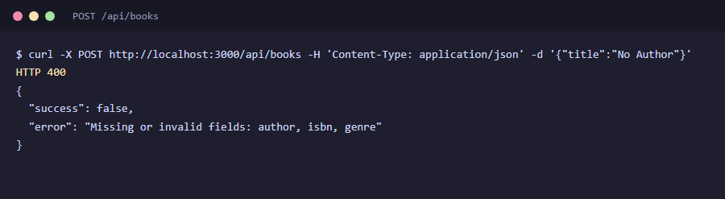

An invalid ISBN returns **400**:

```bash
curl -X POST http://localhost:3000/api/books \
  -H 'Content-Type: application/json' \
  -d '{"title":"Bad","author":"X","isbn":"abc","genre":"fiction"}'
```

```json
{
  "success": false,
  "error": "Invalid isbn. Use 10 or 13 digits, with or without dashes."
}
```

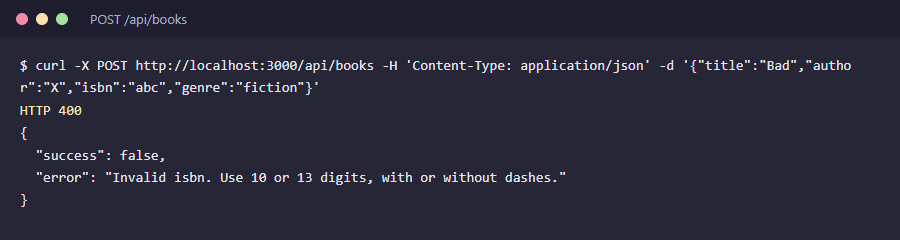

An ISBN that another book already has returns **409 Conflict**:

```bash
curl -X POST http://localhost:3000/api/books \
  -H 'Content-Type: application/json' \
  -d '{"title":"Copy","author":"X","isbn":"978-0-14-018650-2","genre":"fiction"}'
```

```json
{
  "success": false,
  "error": "A book with isbn 978-0-14-018650-2 already exists"
}
```

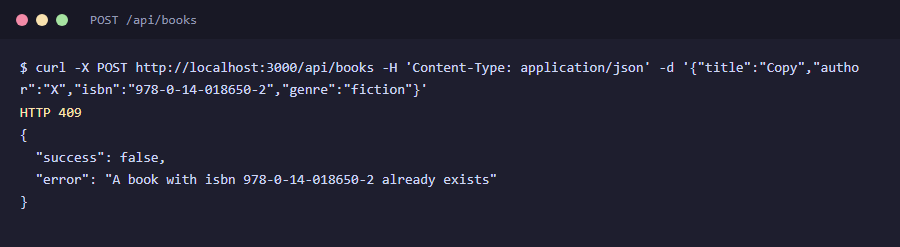

Dashes are ignored when checking for duplicates, so the same ISBN written without dashes also returns **409**:

```bash
curl -X POST http://localhost:3000/api/books \
  -H 'Content-Type: application/json' \
  -d '{"title":"Copy","author":"X","isbn":"9780140186502","genre":"fiction"}'
```

```json
{
  "success": false,
  "error": "A book with isbn 9780140186502 already exists"
}
```

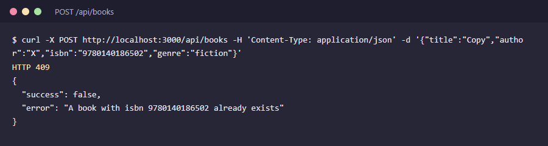

#### 10. Update a book

`PUT` replaces the whole book, so every field is required:

```bash
curl -X PUT http://localhost:3000/api/books/3 \
  -H 'Content-Type: application/json' \
  -d '{"title":"Born a Crime","author":"Trevor Noah","isbn":"978-0-399-59043-2","genre":"memoir","available":true,"borrowedBy":null}'
```

```json
{
  "success": true,
  "data": {
    "id": 3,
    "title": "Born a Crime",
    "author": "Trevor Noah",
    "isbn": "978-0-399-59043-2",
    "genre": "memoir",
    "available": true,
    "borrowedBy": null
  }
}
```

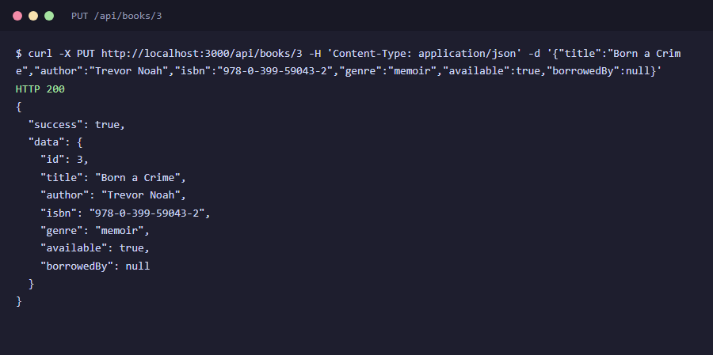

Leaving out `available` and `borrowedBy` returns **400**:

```bash
curl -X PUT http://localhost:3000/api/books/3 \
  -H 'Content-Type: application/json' \
  -d '{"title":"Born a Crime","author":"Trevor Noah","isbn":"978-0-399-59043-2","genre":"memoir"}'
```

```json
{
  "success": false,
  "error": "Missing or invalid fields: available, borrowedBy"
}
```

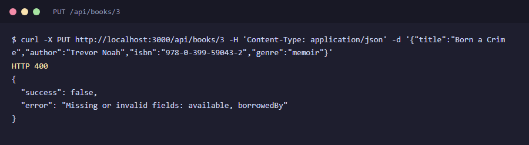

An available book can't have a borrower, so this returns **400**:

```bash
curl -X PUT http://localhost:3000/api/books/3 \
  -H 'Content-Type: application/json' \
  -d '{"title":"Born a Crime","author":"Trevor Noah","isbn":"978-0-399-59043-2","genre":"memoir","available":true,"borrowedBy":"Brian"}'
```

```json
{
  "success": false,
  "error": "borrowedBy must be null when the book is available"
}
```

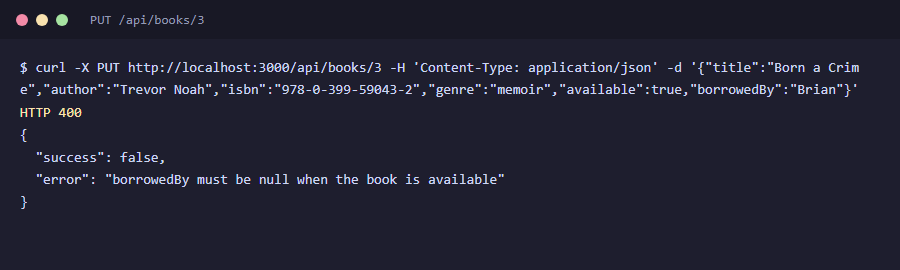

Using another book's ISBN returns **409**:

```bash
curl -X PUT http://localhost:3000/api/books/3 \
  -H 'Content-Type: application/json' \
  -d '{"title":"Born a Crime","author":"Trevor Noah","isbn":"978-0-14-018650-2","genre":"memoir","available":true,"borrowedBy":null}'
```

```json
{
  "success": false,
  "error": "A book with isbn 978-0-14-018650-2 already exists"
}
```

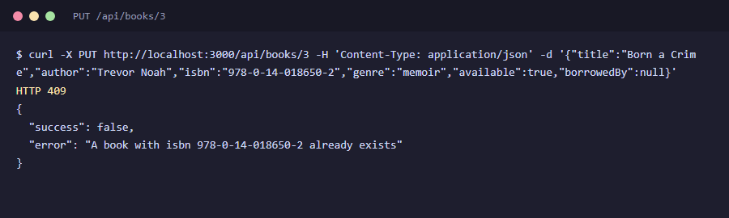

#### 11. Borrow a book

```bash
curl -X POST http://localhost:3000/api/books/1/borrow \
  -H 'Content-Type: application/json' \
  -d '{"borrower":"Wanjiku"}'
```

```json
{
  "success": true,
  "data": {
    "id": 1,
    "title": "Weep Not, Child",
    "author": "Ngugi wa Thiong'o",
    "isbn": "978-0-14-018650-2",
    "genre": "fiction",
    "available": false,
    "borrowedBy": "Wanjiku"
  }
}
```

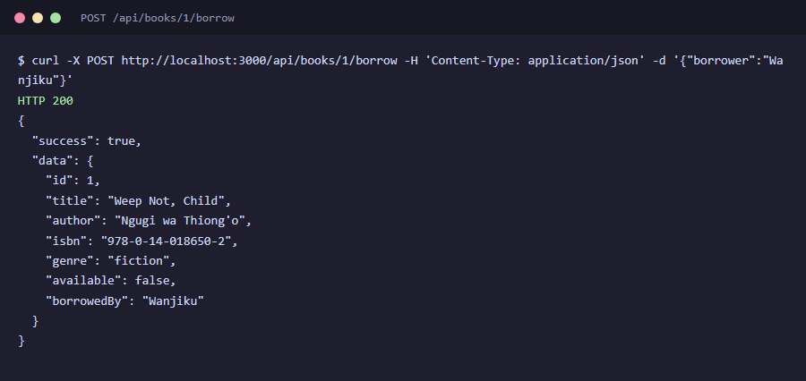

Borrowing the same book again returns **400** with the current borrower's name:

```bash
curl -X POST http://localhost:3000/api/books/1/borrow \
  -H 'Content-Type: application/json' \
  -d '{"borrower":"Brian"}'
```

```json
{
  "success": false,
  "error": "Book is already borrowed by Wanjiku"
}
```

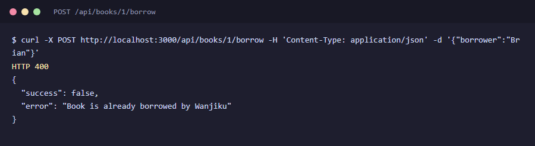

A missing `borrower` returns **400**:

```bash
curl -X POST http://localhost:3000/api/books/4/borrow \
  -H 'Content-Type: application/json' \
  -d '{}'
```

```json
{
  "success": false,
  "error": "Missing or invalid fields: borrower"
}
```

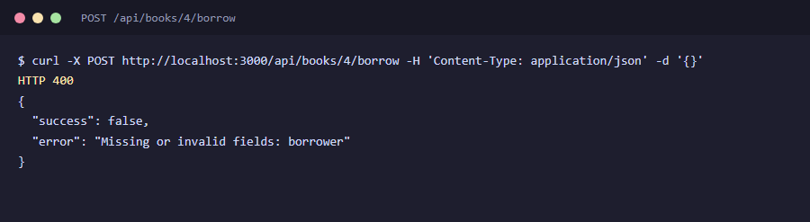

A book that doesn't exist returns **404**:

```bash
curl -X POST http://localhost:3000/api/books/99/borrow \
  -H 'Content-Type: application/json' \
  -d '{"borrower":"Wanjiku"}'
```

```json
{
  "success": false,
  "error": "No book found with id of 99."
}
```

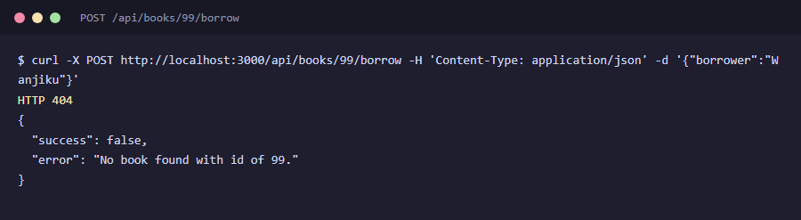

#### 12. Return a book

```bash
curl -X POST http://localhost:3000/api/books/1/return
```

```json
{
  "success": true,
  "data": {
    "id": 1,
    "title": "Weep Not, Child",
    "author": "Ngugi wa Thiong'o",
    "isbn": "978-0-14-018650-2",
    "genre": "fiction",
    "available": true,
    "borrowedBy": null
  }
}
```

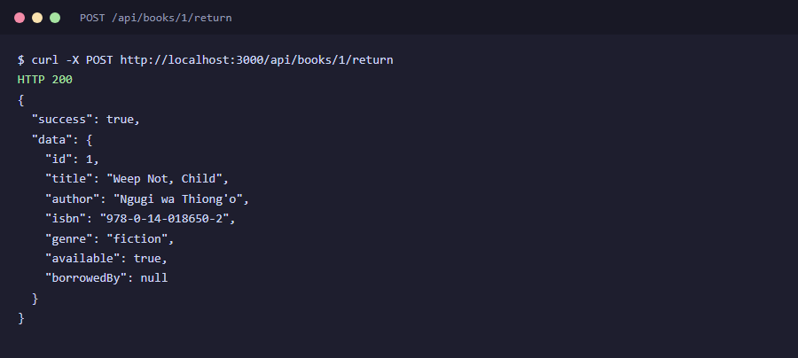

Returning a book that isn't borrowed returns **400**:

```bash
curl -X POST http://localhost:3000/api/books/1/return
```

```json
{
  "success": false,
  "error": "Book is not currently borrowed"
}
```

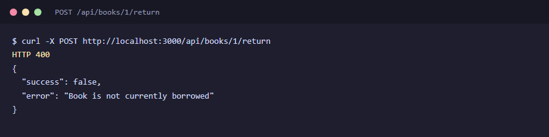

#### 13. Delete a book

A borrowed book can't be deleted, so deleting book 2 returns **400**:

```bash
curl -X DELETE http://localhost:3000/api/books/2
```

```json
{
  "success": false,
  "error": "Cannot delete a book that is currently borrowed"
}
```

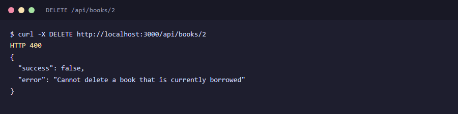

Deleting the book added in step 9 returns **200** with the deleted book:

```bash
curl -X DELETE http://localhost:3000/api/books/9
```

```json
{
  "success": true,
  "data": {
    "id": 9,
    "title": "Petals of Blood",
    "author": "Ngugi wa Thiong'o",
    "isbn": "978-0-14-118702-7",
    "genre": "fiction",
    "available": true,
    "borrowedBy": null
  }
}
```

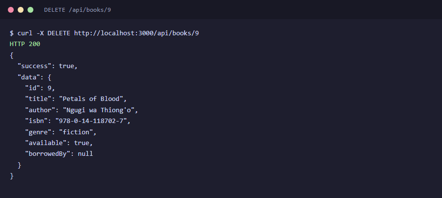

Deleting it again returns **404**:

```bash
curl -X DELETE http://localhost:3000/api/books/9
```

```json
{
  "success": false,
  "error": "No book with id of 9."
}
```

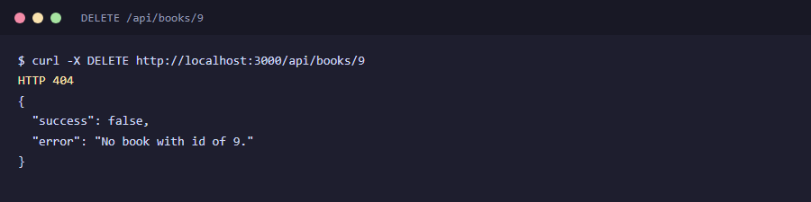

#### 14. Invalid requests

These requests are handled before they reach a book route, and each one still returns JSON.

A query option given more than once returns **400**:

```bash
curl 'http://localhost:3000/api/books?genre=fiction&genre=business'
```

```json
{
  "success": false,
  "error": "Each query option can only be given once: genre"
}
```

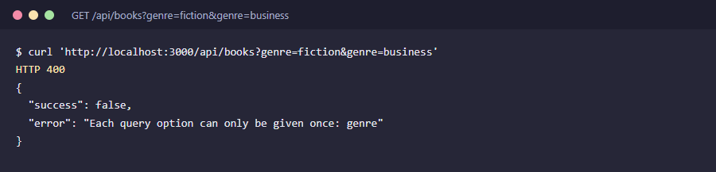

A route that doesn't exist returns **404**:

```bash
curl http://localhost:3000/api/bookz
```

```json
{
  "success": false,
  "error": "Route GET /api/bookz not found"
}
```

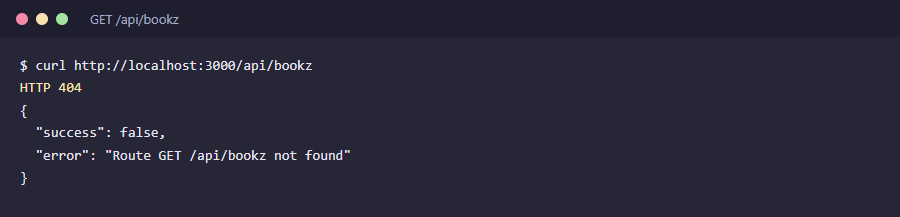

A request body that isn't valid JSON returns **400**:

```bash
curl -X POST http://localhost:3000/api/books \
  -H 'Content-Type: application/json' \
  -d '{"title": "Broken",'
```

```json
{
  "success": false,
  "error": "Request body is not valid JSON"
}
```

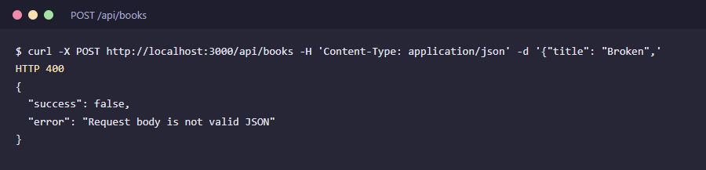
