# Kenyan Cities API (Week 5, Day 1)

A REST API built with Express 5 that manages a list of Kenyan cities. You can list cities, filter them by county or minimum population, fetch one city by ID, add a city, update one, and delete one. The data is kept in memory, so it resets to the original eight cities every time the server restarts.

## Getting started

Requirements: Node.js 18 or later.

```bash
npm install
npm start        # runs node server.js
npm run dev      # runs with nodemon and restarts on file changes
```

The server runs at `http://localhost:3000`.

## Endpoints

| Method | Route | What it does | Success status |
| --- | --- | --- | --- |
| `GET` | `/` | Welcome message and a list of endpoints | 200 |
| `GET` | `/api/cities` | All cities. Supports the `county` and `minPopulation` query filters | 200 |
| `GET` | `/api/cities/:id` | One city by ID | 200 |
| `POST` | `/api/cities` | Adds a city | 201 |
| `PATCH` | `/api/cities/:id` | Updates any of a city's `name`, `county` or `population` | 200 |
| `DELETE` | `/api/cities/:id` | Deletes a city and returns it | 200 |

### Query filters for `GET /api/cities`

| Parameter | Example | Behaviour |
| --- | --- | --- |
| `county` | `?county=nairobi` | Exact match on county, ignoring upper and lower case |
| `minPopulation` | `?minPopulation=500000` | Cities with at least this population. A value that isn't a number returns 400 |

The two filters can be combined: `?county=nairobi&minPopulation=1000000`.

### Validation

| Field | Rule | Applies to |
| --- | --- | --- |
| `name` | Non-empty string | Required on `POST`; optional on `PATCH` |
| `county` | Non-empty string | Required on `POST`; optional on `PATCH` |
| `population` | Number greater than 0 | Required on `POST`; optional on `PATCH` |

Every response includes a boolean `success` field. Failed requests also include an `error` message.

| Status | When |
| --- | --- |
| 400 | Missing or invalid fields, or a `minPopulation` that isn't a number |
| 404 | No city has the given ID |

## Testing with curl

The commands below are for Git Bash, macOS or Linux. In PowerShell, type `curl.exe` instead of `curl` and escape the inner double quotes in the JSON bodies. The responses come from a fresh server and were run in the order shown, so the city added by `POST` gets ID 9 and is then deleted.

### 1. Welcome route

```bash
curl http://localhost:3000/
```

```json
{
  "message": "Welcome to week5 API",
  "version": "1.0.0",
  "endpoints": {
    "cities": "/api/cities"
  }
}
```

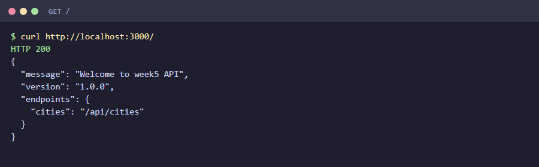

### 2. Get all cities

```bash
curl http://localhost:3000/api/cities
```

```json
{
  "success": true,
  "count": 8,
  "data": [
    { "id": 1, "name": "Nairobi", "county": "Nairobi", "population": 4397073 },
    { "id": 2, "name": "Mombasa", "county": "Mombasa", "population": 1208333 },
    { "id": 3, "name": "Kisumu", "county": "Kisumu", "population": 610082 },
    { "id": 4, "name": "Nakuru", "county": "Nakuru", "population": 570674 },
    { "id": 5, "name": "Eldoret", "county": "Uasin Gishu", "population": 475716 },
    { "id": 6, "name": "Thika", "county": "Kiambu", "population": 279429 },
    { "id": 7, "name": "Malindi", "county": "Kilifi", "population": 207253 },
    { "id": 8, "name": "Kitale", "county": "Trans-Nzoia", "population": 220111 }
  ]
}
```

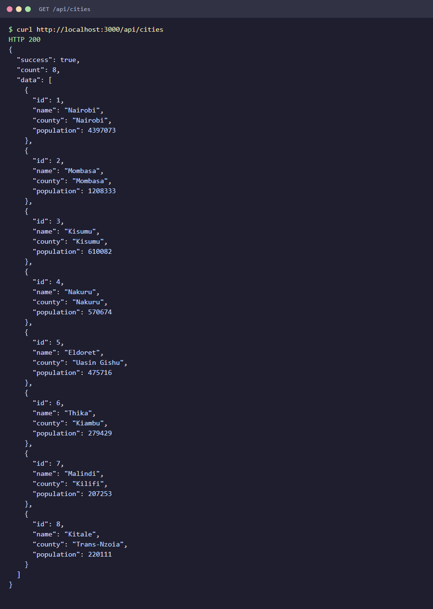

### 3. Filter by county

```bash
curl 'http://localhost:3000/api/cities?county=nairobi'
```

```json
{
  "success": true,
  "count": 1,
  "data": [
    { "id": 1, "name": "Nairobi", "county": "Nairobi", "population": 4397073 }
  ]
}
```

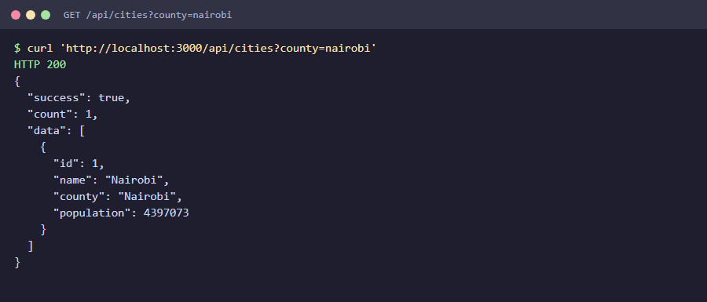

### 4. Filter by minimum population

```bash
curl 'http://localhost:3000/api/cities?minPopulation=500000'
```

```json
{
  "success": true,
  "count": 4,
  "data": [
    { "id": 1, "name": "Nairobi", "county": "Nairobi", "population": 4397073 },
    { "id": 2, "name": "Mombasa", "county": "Mombasa", "population": 1208333 },
    { "id": 3, "name": "Kisumu", "county": "Kisumu", "population": 610082 },
    { "id": 4, "name": "Nakuru", "county": "Nakuru", "population": 570674 }
  ]
}
```

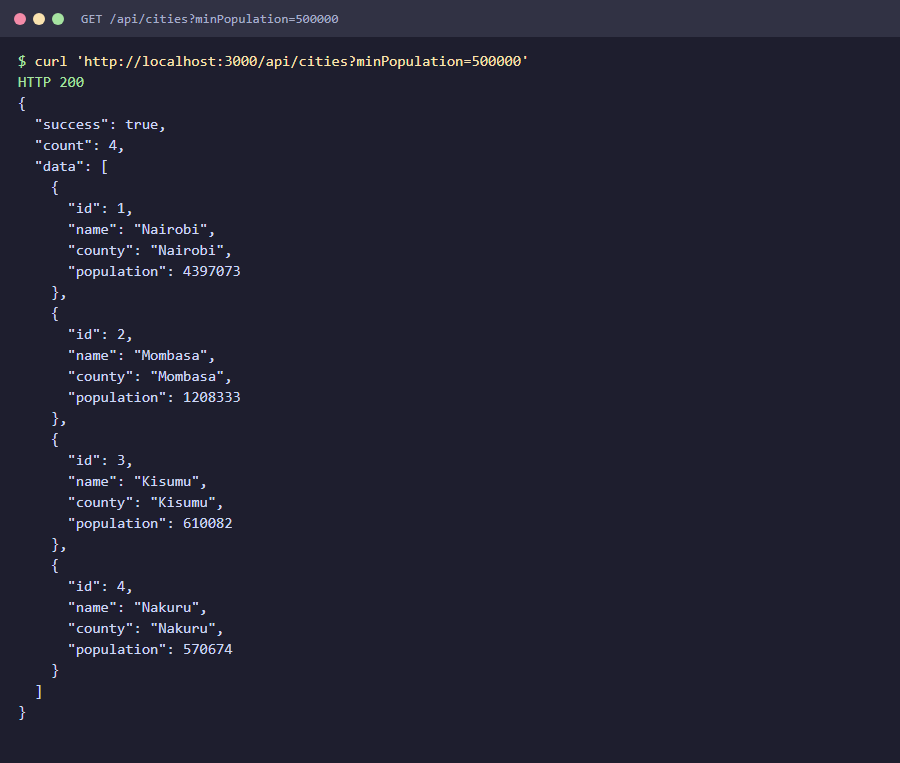

### 5. Get one city

```bash
curl http://localhost:3000/api/cities/3
```

```json
{
  "success": true,
  "data": {
    "id": 3,
    "name": "Kisumu",
    "county": "Kisumu",
    "population": 610082
  }
}
```

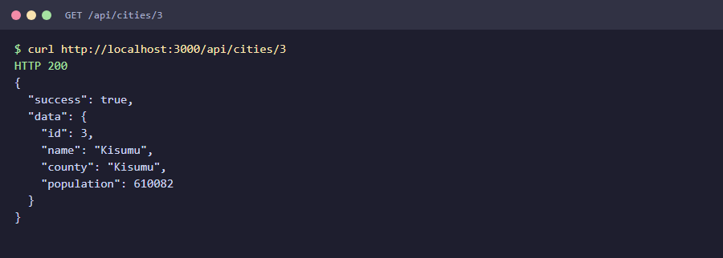

An ID that doesn't exist returns **404**:

```bash
curl http://localhost:3000/api/cities/99
```

```json
{
  "success": false,
  "error": "City not found"
}
```

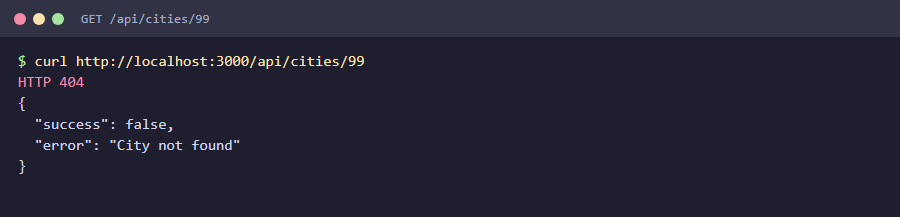

### 6. Add a city

```bash
curl -X POST http://localhost:3000/api/cities \
  -H 'Content-Type: application/json' \
  -d '{"name":"Nyeri","county":"Nyeri","population":139725}'
```

Returns **201 Created**:

```json
{
  "success": true,
  "data": {
    "id": 9,
    "name": "Nyeri",
    "county": "Nyeri",
    "population": 139725
  }
}
```

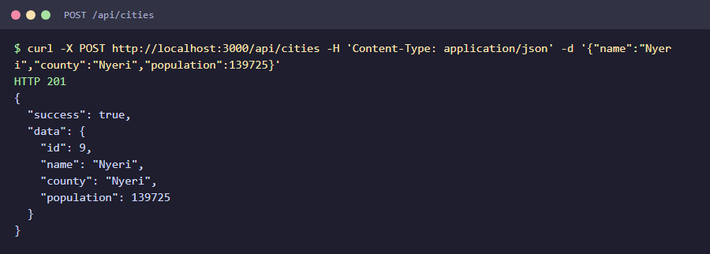

An invalid population returns **400**:

```bash
curl -X POST http://localhost:3000/api/cities \
  -H 'Content-Type: application/json' \
  -d '{"name":"Nyeri","county":"Nyeri","population":-5}'
```

```json
{
  "success": false,
  "error": "Population must be a positive number"
}
```

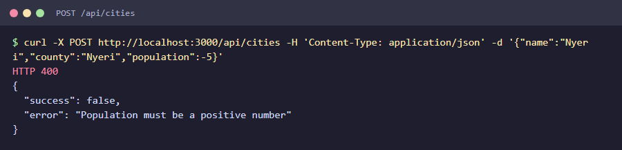

### 7. Update a city

Only the fields you send are changed.

```bash
curl -X PATCH http://localhost:3000/api/cities/1 \
  -H 'Content-Type: application/json' \
  -d '{"population":4500000}'
```

```json
{
  "success": true,
  "message": "City details updated",
  "data": {
    "id": 1,
    "name": "Nairobi",
    "county": "Nairobi",
    "population": 4500000
  }
}
```

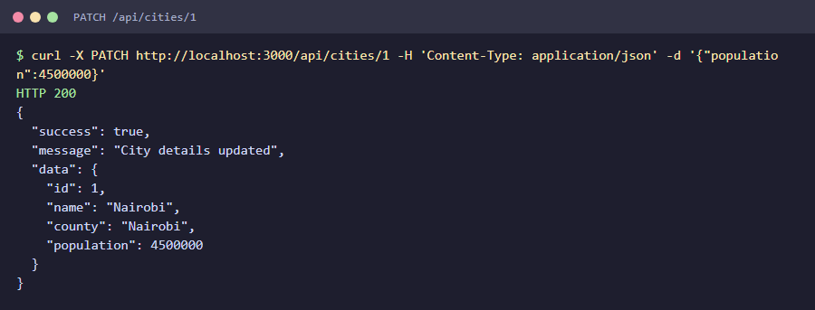

### 8. Delete a city

```bash
curl -X DELETE http://localhost:3000/api/cities/9
```

```json
{
  "success": true,
  "message": "City deleted",
  "data": {
    "id": 9,
    "name": "Nyeri",
    "county": "Nyeri",
    "population": 139725
  }
}
```

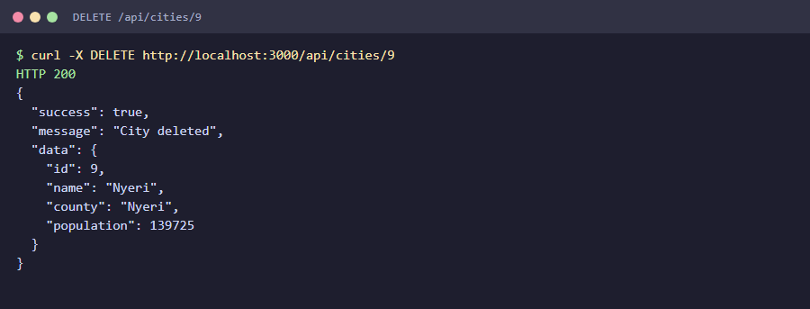

Deleting the same city again returns **404**:

```json
{
  "success": false,
  "error": "City with ID 9 does not exist"
}
```

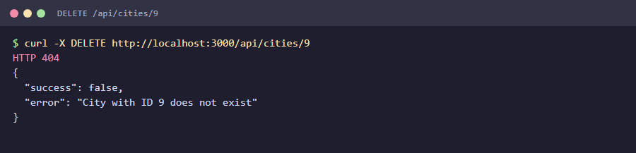

## Project structure

```
week-5-day-1-assignment/
├── server.js          # Express app, in-memory data and all routes
├── package.json
├── screenshots/       # curl output for each endpoint, used in this README
└── README.md
```
