# Kenyan Cities API with Middleware (Week 5, Day 2)

A REST API built with Express 5 that manages a list of Kenyan cities, extended with custom middleware: a request logger, API key authentication, a rate limiter and a central error handler. The data is kept in memory, so it resets to the original eight cities every time the server restarts.

## Getting started

Requirements: Node.js 18 or later.

```bash
npm install
node server.js
```

The server runs at `http://localhost:3000`.

## Middleware

| File | Applied to | What it does |
| --- | --- | --- |
| `middleware/logger.js` | All routes | Logs the method, URL, status code and response time of every request. For `POST`, `PUT` and `PATCH` it also logs the body, with any `password` field replaced by `***` |
| `middleware/rateLimiter.js` | All routes | Allows 10 requests per minute per IP address. Request 11 gets a 429 response and a `Retry-After` header |
| `middleware/auth.js` | `POST /api/cities`, `DELETE /api/cities/:id` | Requires the header `x-api-key: mctaba-2026-secret-key`. A missing or wrong key returns 401 |
| `middleware/errorHandler.js` | All routes (registered last) | Catches thrown errors. An `AppError` returns its own message and status code; any other error is logged to the console and returns a generic 500 |

The middleware runs in this order: `express.json()` → `logger` → `rateLimiter` → routes (with `auth` on protected routes) → `errorHandler`.

### Logger output

```
[2026-10-17T13:22:27.499Z] GET /api/cities 200 - 1ms
[2026-10-17T13:23:28.663Z] POST /api/auth/login 200 - 1ms {"email":"user@test.com","password":"***"}
```

### Rate limiter

Requests are tracked in a `Map` keyed by IP address, holding `{ count, firstRequest }`. The count resets 60 seconds after an IP's first request. Expired entries are removed once a minute so the `Map` doesn't keep growing.

### Error handler

Errors thrown with `AppError` use this format:

```js
throw new AppError('City not found', 404);
```

```json
{ "success": false, "error": { "message": "City not found", "statusCode": 404 } }
```

If `NODE_ENV` is set to `development`, the response also includes the error's `stack`.

## Endpoints

| Method | Route | Auth | What it does | Success status |
| --- | --- | --- | --- | --- |
| `GET` | `/` | No | Welcome message and a list of endpoints | 200 |
| `GET` | `/api/health` | No | Health check | 200 |
| `GET` | `/api/cities` | No | All cities. Supports the `county` and `minPopulation` query filters | 200 |
| `GET` | `/api/cities/:id` | No | One city by ID | 200 |
| `POST` | `/api/cities` | API key | Adds a city | 201 |
| `DELETE` | `/api/cities/:id` | API key | Deletes a city and returns it | 200 |
| `POST` | `/api/auth/login` | No | Checks an email and password against a test user | 200 |
| `GET` | `/api/broken-route` | No | Throws an unexpected error, to test the error handler | 500 |

### Query filters for `GET /api/cities`

| Parameter | Example | Behaviour |
| --- | --- | --- |
| `county` | `?county=nairobi` | Exact match on county, ignoring upper and lower case |
| `minPopulation` | `?minPopulation=500000` | Cities with at least this population. A value that isn't a number returns 400 |

The two filters can be combined: `?county=nairobi&minPopulation=1000000`.

### Validation for `POST /api/cities`

| Field | Rule |
| --- | --- |
| `name` | Required, non-empty string |
| `county` | Required, non-empty string |
| `population` | Required, number greater than 0 |

### Status codes

| Status | When |
| --- | --- |
| 400 | Missing or invalid fields, a `minPopulation` that isn't a number, or a login without email or password |
| 401 | Missing or wrong API key, or a wrong email or password on login |
| 404 | No city has the given ID |
| 429 | More than 10 requests in a minute from the same IP |
| 500 | An unexpected error in a route |

### Test login

| Email | Password |
| --- | --- |
| `user@test.com` | `password123` |

## Testing with curl

The commands below are for Git Bash, macOS or Linux. In PowerShell, type `curl.exe` instead of `curl` and escape the inner double quotes in the JSON bodies. The responses come from a fresh server and were run in the order shown, so the city added by `POST` gets ID 9 and is then deleted.

Because of the rate limiter, running more than 10 of these commands within a minute returns 429. Wait for the time shown in `retryAfter`, or restart the server to clear the count.

### 1. Welcome route

```bash
curl http://localhost:3000/
```

```json
{
  "message": "Welcome to week5 API",
  "version": "1.0.0",
  "endpoints": {
    "cities": "/api/cities"
  }
}
```

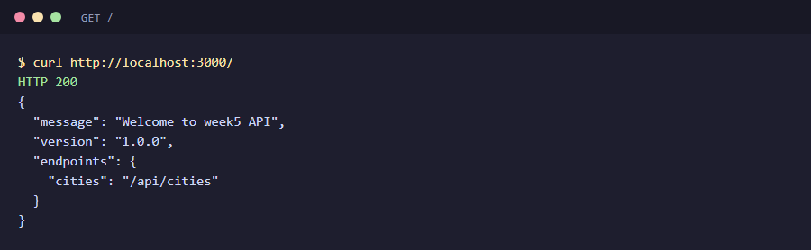

### 2. Health check

```bash
curl http://localhost:3000/api/health
```

```json
{ "status": "ok" }
```

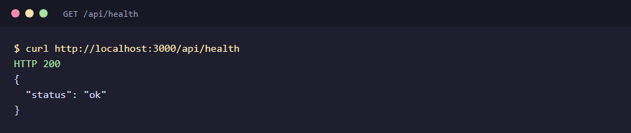

### 3. Get all cities

```bash
curl http://localhost:3000/api/cities
```

```json
{
  "success": true,
  "count": 8,
  "data": [
    { "id": 1, "name": "Nairobi", "county": "Nairobi", "population": 4397073 },
    { "id": 2, "name": "Mombasa", "county": "Mombasa", "population": 1208333 },
    { "id": 3, "name": "Kisumu", "county": "Kisumu", "population": 610082 },
    { "id": 4, "name": "Nakuru", "county": "Nakuru", "population": 570674 },
    { "id": 5, "name": "Eldoret", "county": "Uasin Gishu", "population": 475716 },
    { "id": 6, "name": "Thika", "county": "Kiambu", "population": 279429 },
    { "id": 7, "name": "Malindi", "county": "Kilifi", "population": 207253 },
    { "id": 8, "name": "Kitale", "county": "Trans-Nzoia", "population": 220111 }
  ]
}
```

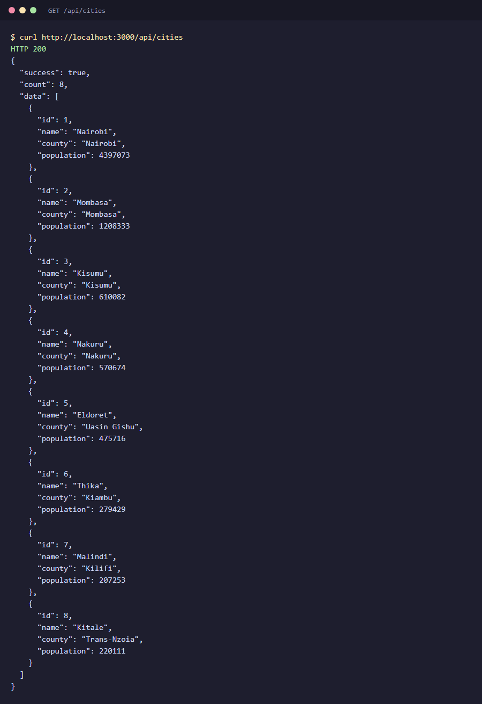

### 4. Filter by county

```bash
curl 'http://localhost:3000/api/cities?county=nairobi'
```

```json
{
  "success": true,
  "count": 1,
  "data": [
    { "id": 1, "name": "Nairobi", "county": "Nairobi", "population": 4397073 }
  ]
}
```

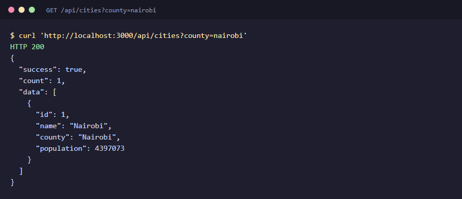

### 5. Filter by minimum population

```bash
curl 'http://localhost:3000/api/cities?minPopulation=500000'
```

```json
{
  "success": true,
  "count": 4,
  "data": [
    { "id": 1, "name": "Nairobi", "county": "Nairobi", "population": 4397073 },
    { "id": 2, "name": "Mombasa", "county": "Mombasa", "population": 1208333 },
    { "id": 3, "name": "Kisumu", "county": "Kisumu", "population": 610082 },
    { "id": 4, "name": "Nakuru", "county": "Nakuru", "population": 570674 }
  ]
}
```

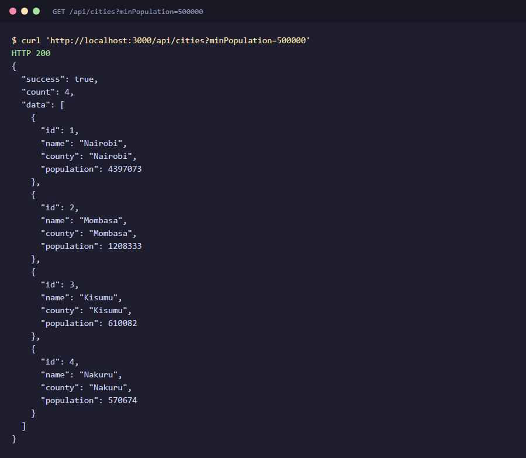

A value that isn't a number returns **400**:

```bash
curl 'http://localhost:3000/api/cities?minPopulation=abc'
```

```json
{
  "success": false,
  "error": "minPopulation must be a number"
}
```

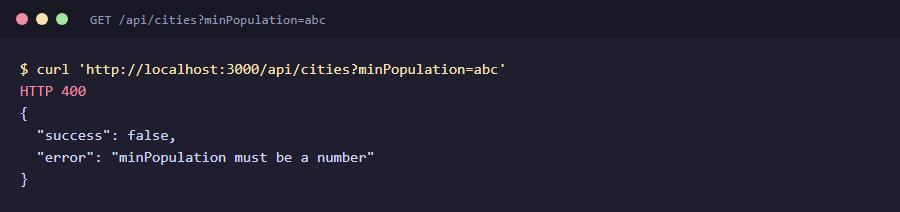

### 6. Get one city

```bash
curl http://localhost:3000/api/cities/3
```

```json
{
  "success": true,
  "data": {
    "id": 3,
    "name": "Kisumu",
    "county": "Kisumu",
    "population": 610082
  }
}
```

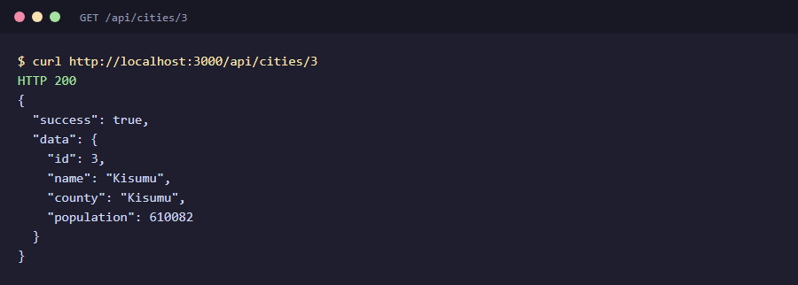

An ID that doesn't exist returns **404** from the error handler:

```bash
curl http://localhost:3000/api/cities/999
```

```json
{
  "success": false,
  "error": {
    "message": "City not found",
    "statusCode": 404
  }
}
```

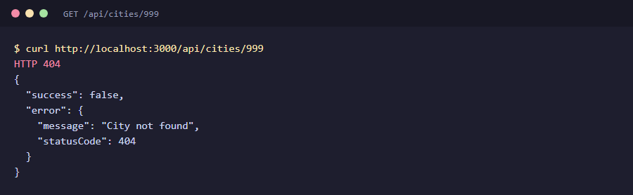

### 7. Add a city (protected)

Without an API key, the request returns **401**:

```bash
curl -X POST http://localhost:3000/api/cities \
  -H 'Content-Type: application/json' \
  -d '{"name":"Nyeri","county":"Nyeri","population":139725}'
```

```json
{
  "error": "API key required. Include x-api-key header."
}
```

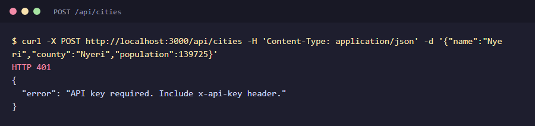

With a wrong key, it also returns **401**:

```bash
curl -X POST http://localhost:3000/api/cities \
  -H 'Content-Type: application/json' \
  -H 'x-api-key: wrong-key' \
  -d '{"name":"Nyeri","county":"Nyeri","population":139725}'
```

```json
{
  "error": "Invalid API key"
}
```

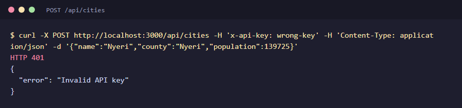

With the correct key, it returns **201 Created**:

```bash
curl -X POST http://localhost:3000/api/cities \
  -H 'Content-Type: application/json' \
  -H 'x-api-key: mctaba-2026-secret-key' \
  -d '{"name":"Nyeri","county":"Nyeri","population":139725}'
```

```json
{
  "success": true,
  "data": {
    "id": 9,
    "name": "Nyeri",
    "county": "Nyeri",
    "population": 139725
  }
}
```

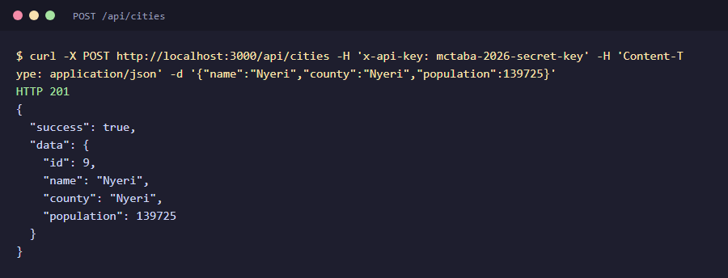

An invalid population returns **400**:

```bash
curl -X POST http://localhost:3000/api/cities \
  -H 'Content-Type: application/json' \
  -H 'x-api-key: mctaba-2026-secret-key' \
  -d '{"name":"Nyeri","county":"Nyeri","population":-5}'
```

```json
{
  "success": false,
  "error": "Population must be a positive number"
}
```

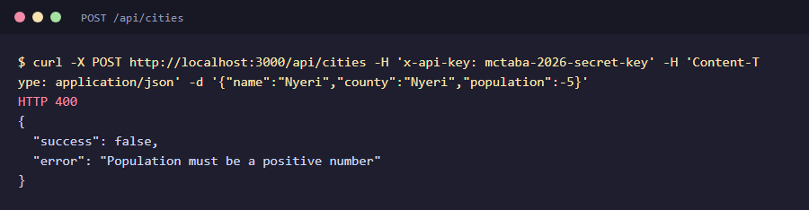

A missing name or county returns **400**:

```bash
curl -X POST http://localhost:3000/api/cities \
  -H 'Content-Type: application/json' \
  -H 'x-api-key: mctaba-2026-secret-key' \
  -d '{"county":"Nyeri","population":5}'
```

```json
{
  "success": false,
  "error": "Name and county are required"
}
```

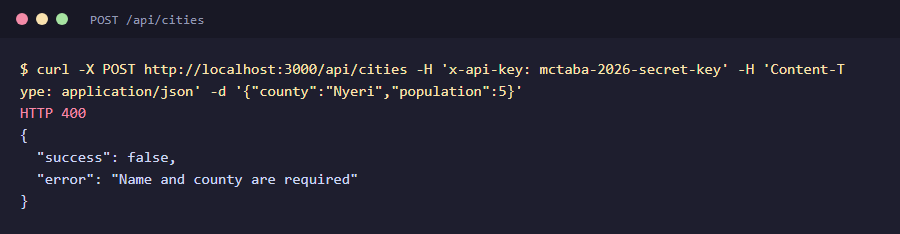

### 8. Delete a city (protected)

```bash
curl -X DELETE http://localhost:3000/api/cities/9 \
  -H 'x-api-key: mctaba-2026-secret-key'
```

```json
{
  "success": true,
  "message": "City deleted",
  "data": {
    "id": 9,
    "name": "Nyeri",
    "county": "Nyeri",
    "population": 139725
  }
}
```

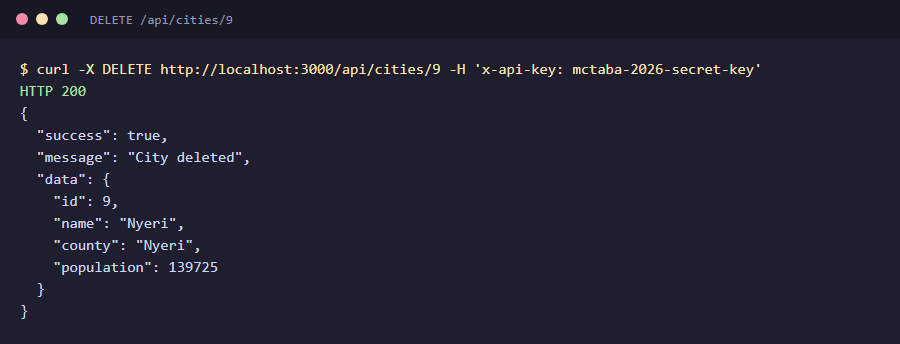

Deleting the same city again returns **404**:

```bash
curl -X DELETE http://localhost:3000/api/cities/9 \n  -H 'x-api-key: mctaba-2026-secret-key'
```

```json
{
  "success": false,
  "error": "City with ID 9 does not exist"
}
```

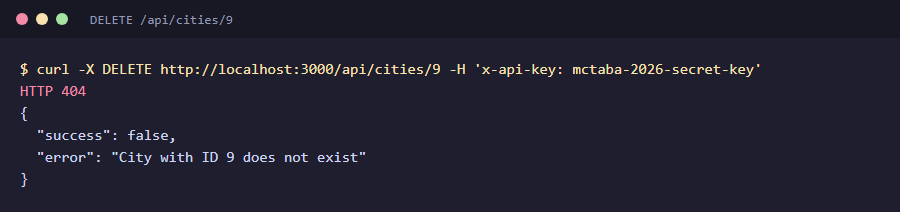

### 9. Login

```bash
curl -X POST http://localhost:3000/api/auth/login \
  -H 'Content-Type: application/json' \
  -d '{"email":"user@test.com","password":"password123"}'
```

```json
{
  "message": "Login successful",
  "user": {
    "id": 1,
    "email": "user@test.com",
    "name": "Test User"
  }
}
```

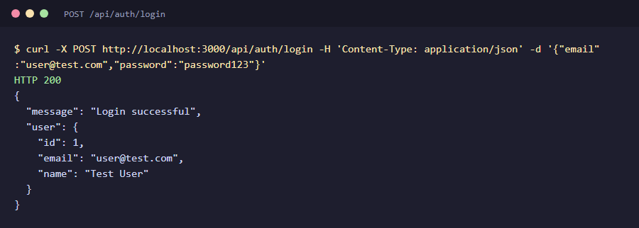

A wrong password returns **401**:

```bash
curl -X POST http://localhost:3000/api/auth/login \n  -H 'Content-Type: application/json' \n  -d '{"email":"user@test.com","password":"wrongpass"}'
```

```json
{
  "error": "Unauthorized",
  "message": "Invalid email or password"
}
```

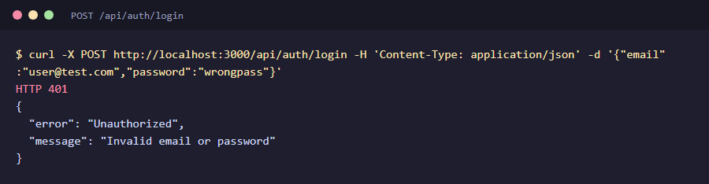

A missing email or password returns **400**:

```bash
curl -X POST http://localhost:3000/api/auth/login \n  -H 'Content-Type: application/json' \n  -d '{"email":"user@test.com"}'
```

```json
{
  "error": "Bad Request",
  "message": "email and password are required"
}
```

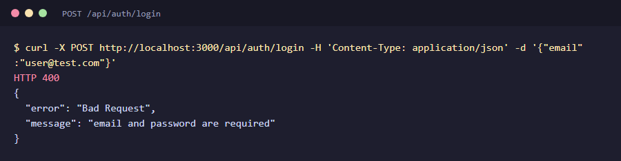

### 10. Unexpected error

```bash
curl http://localhost:3000/api/broken-route
```

Returns **500**. The real error (`Error: Simulated crash`) is printed in the server console, and the client gets a generic message:

```json
{
  "success": false,
  "error": {
    "message": "Something went wrong",
    "statusCode": 500
  }
}
```

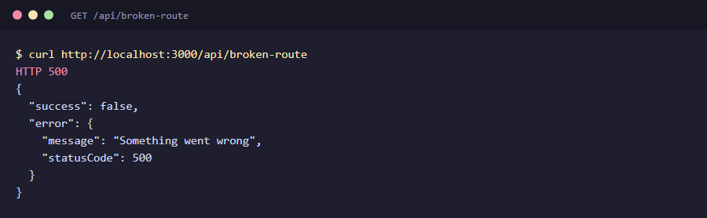

### 11. Rate limit

Send 10 requests, then an 11th that shows the headers:

```bash
for i in $(seq 1 10); do curl -s -o /dev/null -w "%{http_code} " http://localhost:3000/api/health; done
curl -i http://localhost:3000/api/health
```

The first 10 return 200. The 11th returns **429 Too Many Requests** with the header `Retry-After: 60`:

```json
{
  "error": "Too many requests. Try again in 60 seconds.",
  "retryAfter": 60
}
```

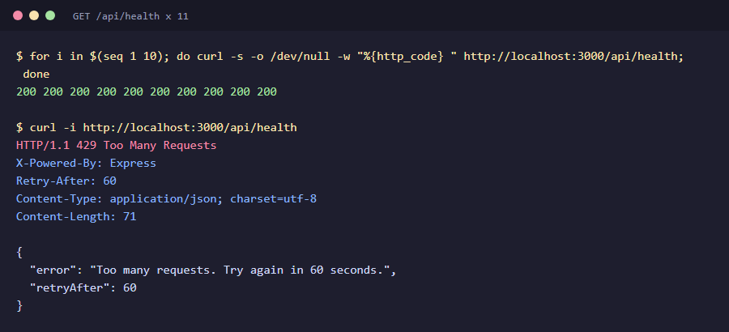

### 12. Server console

The logger prints one line per request. Login bodies show the password as `***`, and the error handler prints the real error behind the 500:

```
[2026-10-17T13:43:24.440Z] POST /api/auth/login 200 - 2ms {"email":"user@test.com","password":"***"}
[2026-10-17T13:44:29.081Z] POST /api/auth/login 401 - 1ms {"email":"user@test.com","password":"***"}
[2026-10-17T13:45:35.649Z] POST /api/auth/login 400 - 2ms {"email":"user@test.com"}
Error: Simulated crash
    at ...week-5-day-2-assignmentserver.js:166:13
[2026-10-17T13:46:41.149Z] GET /api/broken-route 500 - 3ms
```

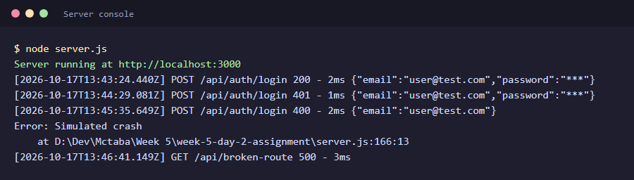

## Project structure

```
week-5-day-2-assignment/
├── server.js              # Express app, in-memory data and all routes
├── middleware/
│   ├── auth.js            # API key check for protected routes
│   ├── errorHandler.js    # AppError class and the central error handler
│   ├── logger.js          # Request logger with password masking
│   └── rateLimiter.js     # 10 requests per minute per IP
├── screenshots/           # curl output for each endpoint, used in this README
├── package.json
└── README.md
```
