# Books API with Borrow and Return (Week 5, Day 3)

A REST API built with Express 5 that manages a small library of books. Besides the usual create, read, update and delete routes, it lets you borrow and return books, and the list route supports filtering, search, sorting and pagination. The data is kept in memory, so it resets to the original eight books every time the server restarts.

## Getting started

Requirements: Node.js 18 or later.

```bash
npm install
node server.js
```

The server runs at `http://localhost:3000`.

## Endpoints

| Method | Route | What it does | Success status |
| --- | --- | --- | --- |
| `GET` | `/` | Welcome message and a list of endpoints | 200 |
| `GET` | `/api/books` | All books. Supports filtering, search, sorting and pagination | 200 |
| `GET` | `/api/books/:id` | One book by ID | 200 |
| `POST` | `/api/books` | Adds a book | 201 |
| `PUT` | `/api/books/:id` | Replaces a book (every field required) | 200 |
| `DELETE` | `/api/books/:id` | Deletes a book and returns it. Borrowed books can't be deleted | 200 |
| `POST` | `/api/books/:id/borrow` | Borrows a book | 200 |
| `POST` | `/api/books/:id/return` | Returns a borrowed book | 200 |

### Query options for `GET /api/books`

| Parameter | Example | Behaviour |
| --- | --- | --- |
| `genre` | `?genre=fiction` | Exact match on genre, ignoring upper and lower case. No matches returns 404 |
| `available` | `?available=true` | `true` or `false` only. Any other value returns 400 |
| `search` | `?search=ngugi` | Books whose title or author contains the text, ignoring case. No matches returns 404 |
| `sort` | `?sort=title` | `title` or `author` only. Any other value returns 400 |
| `order` | `?order=desc` | `asc` (default) or `desc`. Only used with `sort` |
| `page` | `?page=2` | Page number, default 1. Must be a whole number of at least 1 |
| `limit` | `?limit=3` | Books per page, default 10. Must be a whole number of at least 1 |

The options can be combined, for example `?genre=fiction&available=true&sort=title&page=1&limit=2`. Filters and search run first, then sorting, then pagination. Every response from this route includes a `pagination` object:

```json
"pagination": { "page": 1, "limit": 3, "total": 8, "totalPages": 3 }
```

`count` is the number of books on the current page, and `total` is the number of books that matched before paging.

### Validation

| Route | Rule |
| --- | --- |
| `POST /api/books` | `title`, `author`, `isbn` and `genre` are required, non-empty strings |
| `PUT /api/books/:id` | Same as `POST`, plus `available` (boolean) and `borrowedBy` are required |
| `POST` and `PUT` | `isbn` must contain only digits and dashes, include both, and be at least 10 characters. It must not already belong to another book |
| `PUT` | If `available` is `true`, `borrowedBy` must be `null`. If `available` is `false`, `borrowedBy` must be a name |
| `POST /api/books/:id/borrow` | `borrower` is a required, non-empty string |

### Status codes

| Status | When |
| --- | --- |
| 400 | Missing or invalid fields, an ID that isn't a number, an invalid query option, borrowing a book that is already borrowed, returning a book that isn't borrowed, or deleting a borrowed book |
| 404 | No book has the given ID, or a genre filter or search has no matches |
| 409 | The ISBN already belongs to another book |

## Testing with curl

The commands below are for Git Bash, macOS or Linux. In Windows cmd, put the JSON body in double quotes and escape the inner quotes, for example `-d "{\"borrower\":\"Wanjiku\"}"`. The responses come from a fresh server and were run in the order shown, so the book added by `POST` gets ID 9 and is deleted at the end.

### 1. Welcome route

```bash
curl http://localhost:3000/
```

```json
{
  "message": "Welcome to Books API",
  "version": "1.0.0",
  "endpoints": {
    "listBooks": "GET /api/books?genre=&available=&search=&sort=title|author&order=asc|desc&page=&limit=",
    "getBook": "GET /api/books/:id",
    "createBook": "POST /api/books",
    "updateBook": "PUT /api/books/:id",
    "deleteBook": "DELETE /api/books/:id",
    "borrowBook": "POST /api/books/:id/borrow",
    "returnBook": "POST /api/books/:id/return"
  }
}
```

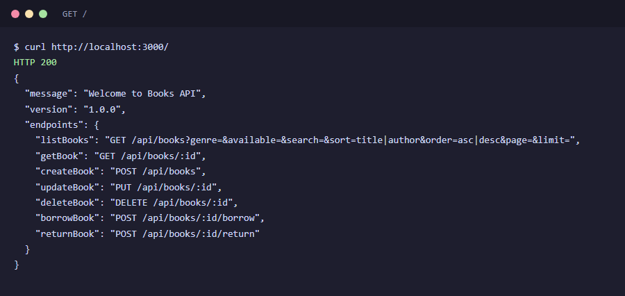

### 2. Get all books

```bash
curl http://localhost:3000/api/books
```

```json
{
  "success": true,
  "count": 8,
  "data": [
    { "id": 1, "title": "Weep Not, Child", "author": "Ngugi wa Thiong'o", "isbn": "978-0-14-018650-2", "genre": "fiction", "available": true, "borrowedBy": null },
    { "id": 2, "title": "The River Between", "author": "Ngugi wa Thiong'o", "isbn": "978-0-14-018651-9", "genre": "fiction", "available": false, "borrowedBy": "Amina Wanjiku" },
    { "id": 3, "title": "Born a Crime", "author": "Trevor Noah", "isbn": "978-0-399-59043-2", "genre": "autobiography", "available": true, "borrowedBy": null },
    { "id": 4, "title": "Americanah", "author": "Chimamanda Ngozi Adichie", "isbn": "978-0-307-45592-8", "genre": "fiction", "available": true, "borrowedBy": null },
    { "id": 5, "title": "The Lean Startup", "author": "Eric Ries", "isbn": "978-0-307-88789-4", "genre": "business", "available": false, "borrowedBy": "Brian Ochieng" },
    { "id": 6, "title": "Clean Code", "author": "Robert C. Martin", "isbn": "978-0-13-235088-4", "genre": "technology", "available": true, "borrowedBy": null },
    { "id": 7, "title": "Dust", "author": "Yvonne Adhiambo Owuor", "isbn": "978-1-78470-045-2", "genre": "fiction", "available": true, "borrowedBy": null },
    { "id": 8, "title": "Half of a Yellow Sun", "author": "Chimamanda Ngozi Adichie", "isbn": "978-1-4000-9520-3", "genre": "fiction", "available": true, "borrowedBy": null }
  ],
  "pagination": {
    "page": 1,
    "limit": 10,
    "total": 8,
    "totalPages": 1
  }
}
```

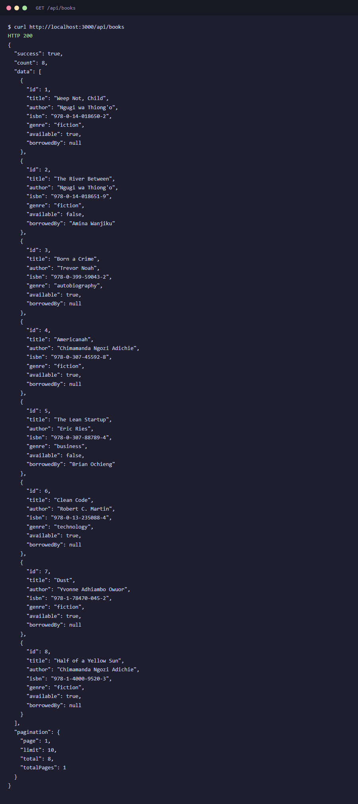

### 3. Filter by genre

```bash
curl 'http://localhost:3000/api/books?genre=fiction'
```

```json
{
  "success": true,
  "count": 5,
  "data": [
    { "id": 1, "title": "Weep Not, Child", "author": "Ngugi wa Thiong'o", "isbn": "978-0-14-018650-2", "genre": "fiction", "available": true, "borrowedBy": null },
    { "id": 2, "title": "The River Between", "author": "Ngugi wa Thiong'o", "isbn": "978-0-14-018651-9", "genre": "fiction", "available": false, "borrowedBy": "Amina Wanjiku" },
    { "id": 4, "title": "Americanah", "author": "Chimamanda Ngozi Adichie", "isbn": "978-0-307-45592-8", "genre": "fiction", "available": true, "borrowedBy": null },
    { "id": 7, "title": "Dust", "author": "Yvonne Adhiambo Owuor", "isbn": "978-1-78470-045-2", "genre": "fiction", "available": true, "borrowedBy": null },
    { "id": 8, "title": "Half of a Yellow Sun", "author": "Chimamanda Ngozi Adichie", "isbn": "978-1-4000-9520-3", "genre": "fiction", "available": true, "borrowedBy": null }
  ],
  "pagination": {
    "page": 1,
    "limit": 10,
    "total": 5,
    "totalPages": 1
  }
}
```

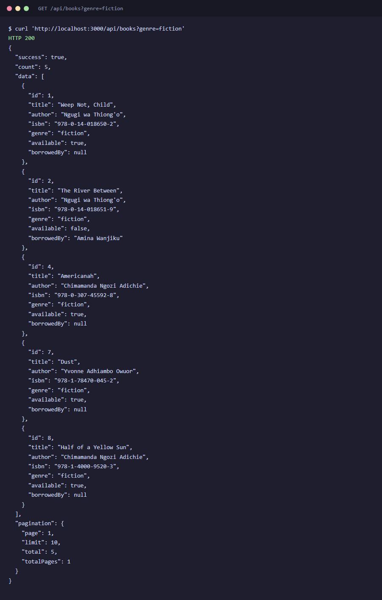

A genre with no books returns **404**:

```bash
curl 'http://localhost:3000/api/books?genre=poetry'
```

```json
{
  "success": false,
  "error": "No books found in poetry genre"
}
```

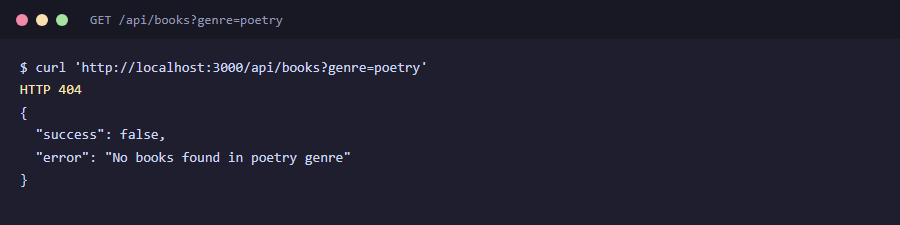

### 4. Filter by availability

```bash
curl 'http://localhost:3000/api/books?available=true'
```

```json
{
  "success": true,
  "count": 6,
  "data": [
    { "id": 1, "title": "Weep Not, Child", "author": "Ngugi wa Thiong'o", "isbn": "978-0-14-018650-2", "genre": "fiction", "available": true, "borrowedBy": null },
    { "id": 3, "title": "Born a Crime", "author": "Trevor Noah", "isbn": "978-0-399-59043-2", "genre": "autobiography", "available": true, "borrowedBy": null },
    { "id": 4, "title": "Americanah", "author": "Chimamanda Ngozi Adichie", "isbn": "978-0-307-45592-8", "genre": "fiction", "available": true, "borrowedBy": null },
    { "id": 6, "title": "Clean Code", "author": "Robert C. Martin", "isbn": "978-0-13-235088-4", "genre": "technology", "available": true, "borrowedBy": null },
    { "id": 7, "title": "Dust", "author": "Yvonne Adhiambo Owuor", "isbn": "978-1-78470-045-2", "genre": "fiction", "available": true, "borrowedBy": null },
    { "id": 8, "title": "Half of a Yellow Sun", "author": "Chimamanda Ngozi Adichie", "isbn": "978-1-4000-9520-3", "genre": "fiction", "available": true, "borrowedBy": null }
  ],
  "pagination": {
    "page": 1,
    "limit": 10,
    "total": 6,
    "totalPages": 1
  }
}
```

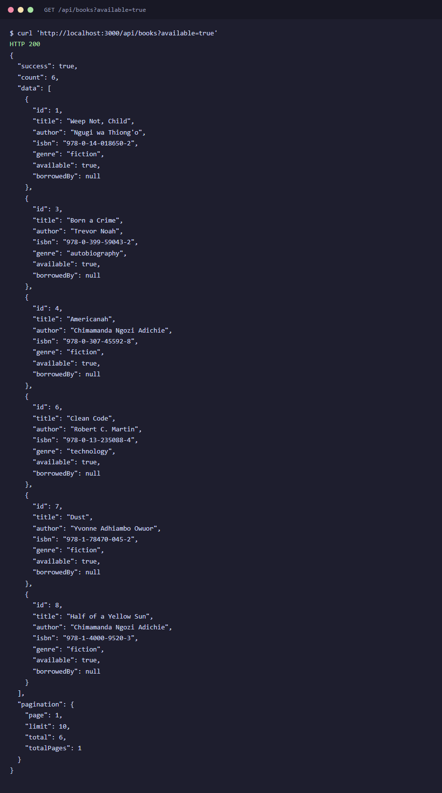

A value other than `true` or `false` returns **400**:

```bash
curl 'http://localhost:3000/api/books?available=maybe'
```

```json
{
  "success": false,
  "error": "Available filter can be set as true or false only."
}
```

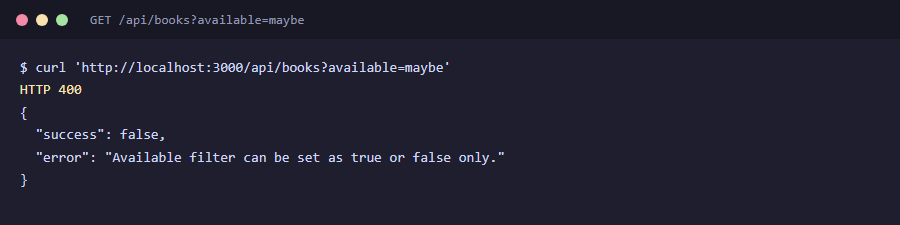

### 5. Search by title or author

```bash
curl 'http://localhost:3000/api/books?search=ngugi'
```

```json
{
  "success": true,
  "count": 2,
  "data": [
    { "id": 1, "title": "Weep Not, Child", "author": "Ngugi wa Thiong'o", "isbn": "978-0-14-018650-2", "genre": "fiction", "available": true, "borrowedBy": null },
    { "id": 2, "title": "The River Between", "author": "Ngugi wa Thiong'o", "isbn": "978-0-14-018651-9", "genre": "fiction", "available": false, "borrowedBy": "Amina Wanjiku" }
  ],
  "pagination": {
    "page": 1,
    "limit": 10,
    "total": 2,
    "totalPages": 1
  }
}
```

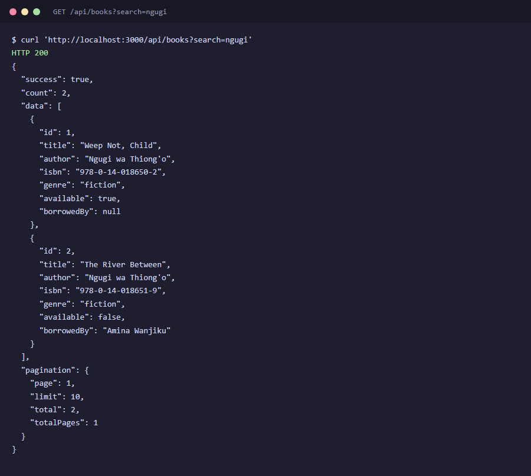

A search with no matches returns **404**:

```bash
curl 'http://localhost:3000/api/books?search=xyz'
```

```json
{
  "success": false,
  "error": "No books match 'xyz'"
}
```

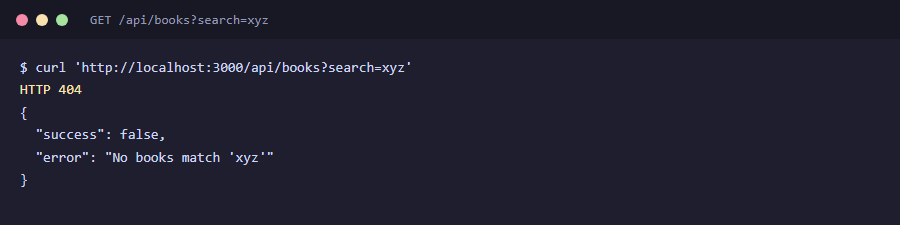

### 6. Pagination

Page 1 with 3 books per page:

```bash
curl 'http://localhost:3000/api/books?page=1&limit=3'
```

```json
{
  "success": true,
  "count": 3,
  "data": [
    { "id": 1, "title": "Weep Not, Child", "author": "Ngugi wa Thiong'o", "isbn": "978-0-14-018650-2", "genre": "fiction", "available": true, "borrowedBy": null },
    { "id": 2, "title": "The River Between", "author": "Ngugi wa Thiong'o", "isbn": "978-0-14-018651-9", "genre": "fiction", "available": false, "borrowedBy": "Amina Wanjiku" },
    { "id": 3, "title": "Born a Crime", "author": "Trevor Noah", "isbn": "978-0-399-59043-2", "genre": "autobiography", "available": true, "borrowedBy": null }
  ],
  "pagination": {
    "page": 1,
    "limit": 3,
    "total": 8,
    "totalPages": 3
  }
}
```

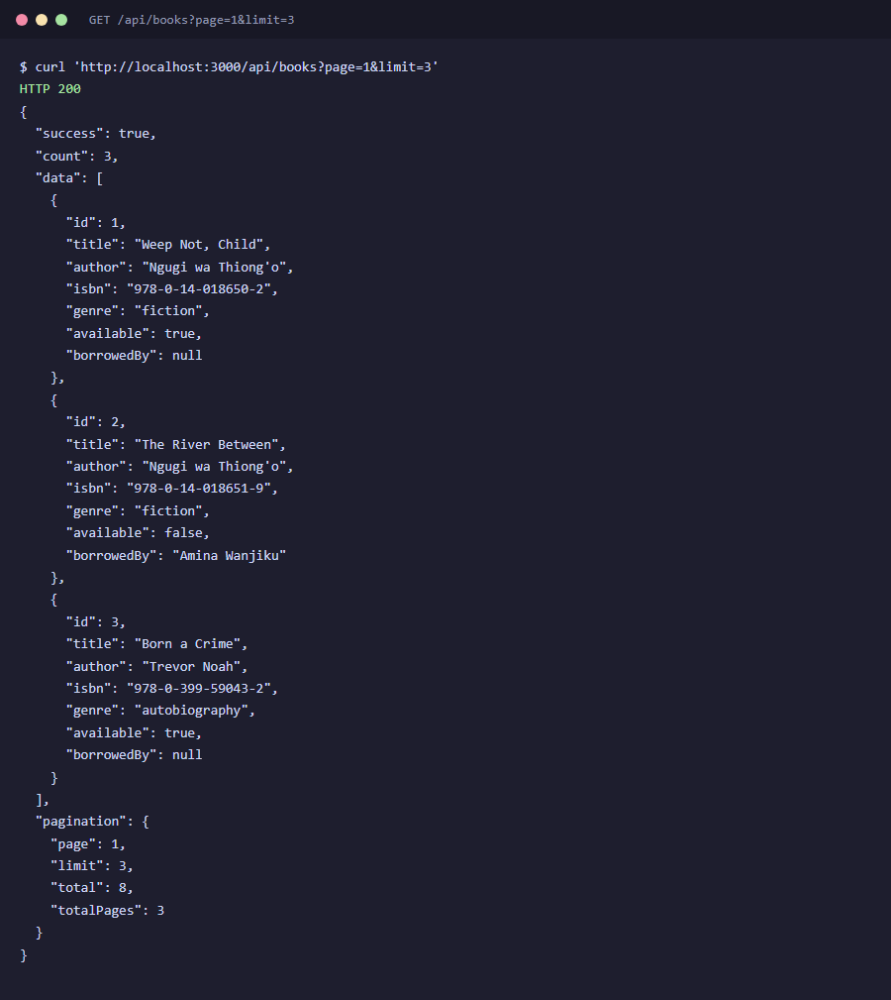

Page 2 skips the first 3 books:

```bash
curl 'http://localhost:3000/api/books?page=2&limit=3'
```

```json
{
  "success": true,
  "count": 3,
  "data": [
    { "id": 4, "title": "Americanah", "author": "Chimamanda Ngozi Adichie", "isbn": "978-0-307-45592-8", "genre": "fiction", "available": true, "borrowedBy": null },
    { "id": 5, "title": "The Lean Startup", "author": "Eric Ries", "isbn": "978-0-307-88789-4", "genre": "business", "available": false, "borrowedBy": "Brian Ochieng" },
    { "id": 6, "title": "Clean Code", "author": "Robert C. Martin", "isbn": "978-0-13-235088-4", "genre": "technology", "available": true, "borrowedBy": null }
  ],
  "pagination": {
    "page": 2,
    "limit": 3,
    "total": 8,
    "totalPages": 3
  }
}
```

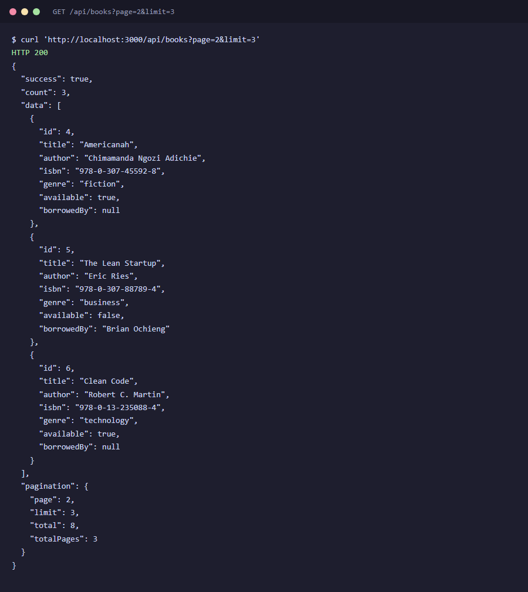

A page or limit that isn't a positive whole number returns **400**:

```bash
curl 'http://localhost:3000/api/books?page=0&limit=3'
```

```json
{
  "success": false,
  "error": "Page and limit must be positive whole numbers."
}
```

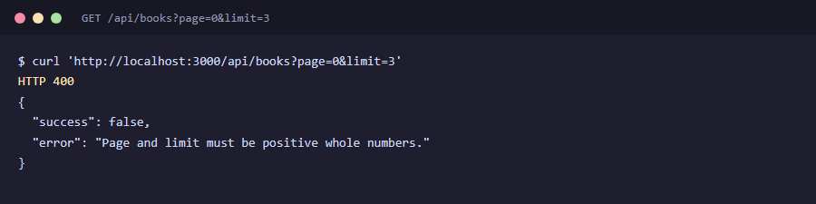

### 7. Sorting

By title, A to Z:

```bash
curl 'http://localhost:3000/api/books?sort=title&order=asc'
```

```json
{
  "success": true,
  "count": 8,
  "data": [
    { "id": 4, "title": "Americanah", "author": "Chimamanda Ngozi Adichie", "isbn": "978-0-307-45592-8", "genre": "fiction", "available": true, "borrowedBy": null },
    { "id": 3, "title": "Born a Crime", "author": "Trevor Noah", "isbn": "978-0-399-59043-2", "genre": "autobiography", "available": true, "borrowedBy": null },
    { "id": 6, "title": "Clean Code", "author": "Robert C. Martin", "isbn": "978-0-13-235088-4", "genre": "technology", "available": true, "borrowedBy": null },
    { "id": 7, "title": "Dust", "author": "Yvonne Adhiambo Owuor", "isbn": "978-1-78470-045-2", "genre": "fiction", "available": true, "borrowedBy": null },
    { "id": 8, "title": "Half of a Yellow Sun", "author": "Chimamanda Ngozi Adichie", "isbn": "978-1-4000-9520-3", "genre": "fiction", "available": true, "borrowedBy": null },
    { "id": 5, "title": "The Lean Startup", "author": "Eric Ries", "isbn": "978-0-307-88789-4", "genre": "business", "available": false, "borrowedBy": "Brian Ochieng" },
    { "id": 2, "title": "The River Between", "author": "Ngugi wa Thiong'o", "isbn": "978-0-14-018651-9", "genre": "fiction", "available": false, "borrowedBy": "Amina Wanjiku" },
    { "id": 1, "title": "Weep Not, Child", "author": "Ngugi wa Thiong'o", "isbn": "978-0-14-018650-2", "genre": "fiction", "available": true, "borrowedBy": null }
  ],
  "pagination": {
    "page": 1,
    "limit": 10,
    "total": 8,
    "totalPages": 1
  }
}
```

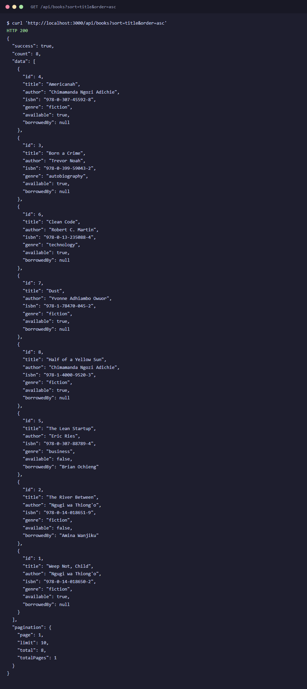

By author, Z to A:

```bash
curl 'http://localhost:3000/api/books?sort=author&order=desc'
```

```json
{
  "success": true,
  "count": 8,
  "data": [
    { "id": 7, "title": "Dust", "author": "Yvonne Adhiambo Owuor", "isbn": "978-1-78470-045-2", "genre": "fiction", "available": true, "borrowedBy": null },
    { "id": 3, "title": "Born a Crime", "author": "Trevor Noah", "isbn": "978-0-399-59043-2", "genre": "autobiography", "available": true, "borrowedBy": null },
    { "id": 6, "title": "Clean Code", "author": "Robert C. Martin", "isbn": "978-0-13-235088-4", "genre": "technology", "available": true, "borrowedBy": null },
    { "id": 2, "title": "The River Between", "author": "Ngugi wa Thiong'o", "isbn": "978-0-14-018651-9", "genre": "fiction", "available": false, "borrowedBy": "Amina Wanjiku" },
    { "id": 1, "title": "Weep Not, Child", "author": "Ngugi wa Thiong'o", "isbn": "978-0-14-018650-2", "genre": "fiction", "available": true, "borrowedBy": null },
    { "id": 5, "title": "The Lean Startup", "author": "Eric Ries", "isbn": "978-0-307-88789-4", "genre": "business", "available": false, "borrowedBy": "Brian Ochieng" },
    { "id": 8, "title": "Half of a Yellow Sun", "author": "Chimamanda Ngozi Adichie", "isbn": "978-1-4000-9520-3", "genre": "fiction", "available": true, "borrowedBy": null },
    { "id": 4, "title": "Americanah", "author": "Chimamanda Ngozi Adichie", "isbn": "978-0-307-45592-8", "genre": "fiction", "available": true, "borrowedBy": null }
  ],
  "pagination": {
    "page": 1,
    "limit": 10,
    "total": 8,
    "totalPages": 1
  }
}
```

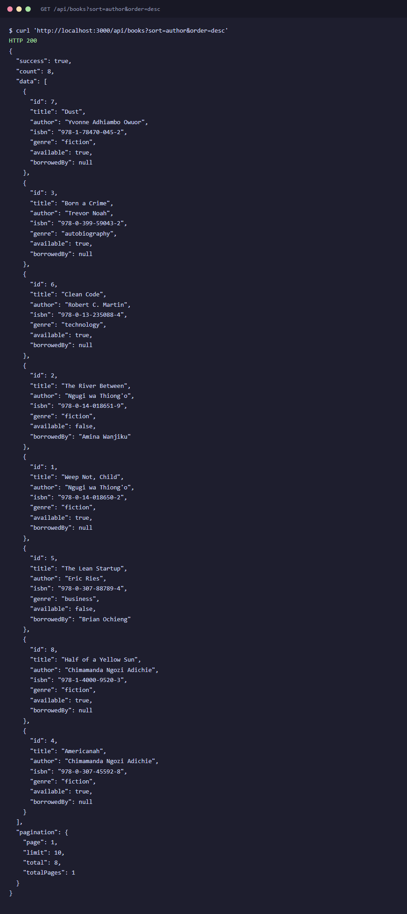

Sorting by any field other than `title` or `author` returns **400**:

```bash
curl 'http://localhost:3000/api/books?sort=price'
```

```json
{
  "success": false,
  "error": "Sort can be set as title or author only."
}
```

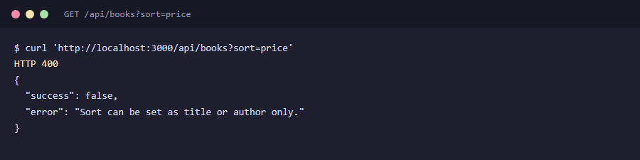

### 8. Get one book

```bash
curl http://localhost:3000/api/books/1
```

```json
{
  "success": true,
  "data": {
    "id": 1,
    "title": "Weep Not, Child",
    "author": "Ngugi wa Thiong'o",
    "isbn": "978-0-14-018650-2",
    "genre": "fiction",
    "available": true,
    "borrowedBy": null
  }
}
```

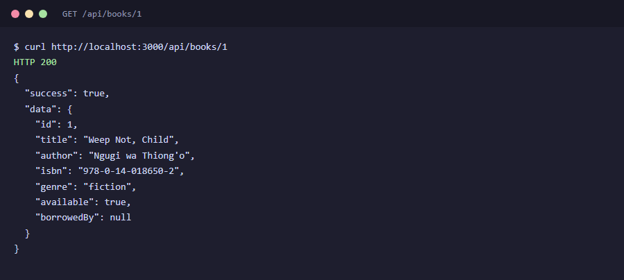

An ID that doesn't exist returns **404**:

```bash
curl http://localhost:3000/api/books/99
```

```json
{
  "success": false,
  "error": "No book with id of 99."
}
```

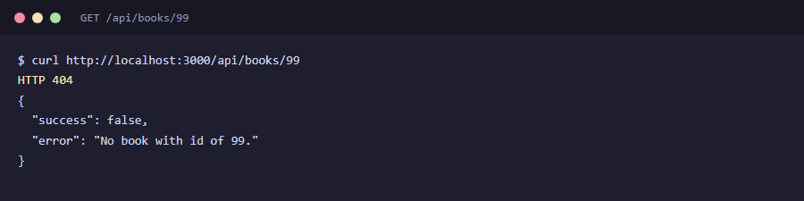

An ID that isn't a number returns **400**:

```bash
curl http://localhost:3000/api/books/abc
```

```json
{
  "success": false,
  "error": "'abc' is not a valid book id. Use a number."
}
```

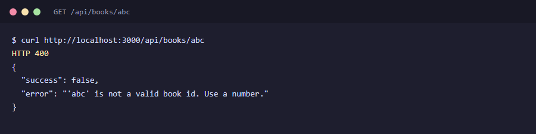

### 9. Add a book

Returns **201 Created**. New books start as available with no borrower, and the genre is saved in lower case:

```bash
curl -X POST http://localhost:3000/api/books \
  -H 'Content-Type: application/json' \
  -d '{"title":"Petals of Blood","author":"Ngugi wa Thiong'\''o","isbn":"978-0-14-118702-7","genre":"fiction"}'
```

```json
{
  "success": true,
  "data": {
    "id": 9,
    "title": "Petals of Blood",
    "author": "Ngugi wa Thiong'o",
    "isbn": "978-0-14-118702-7",
    "genre": "fiction",
    "available": true,
    "borrowedBy": null
  }
}
```

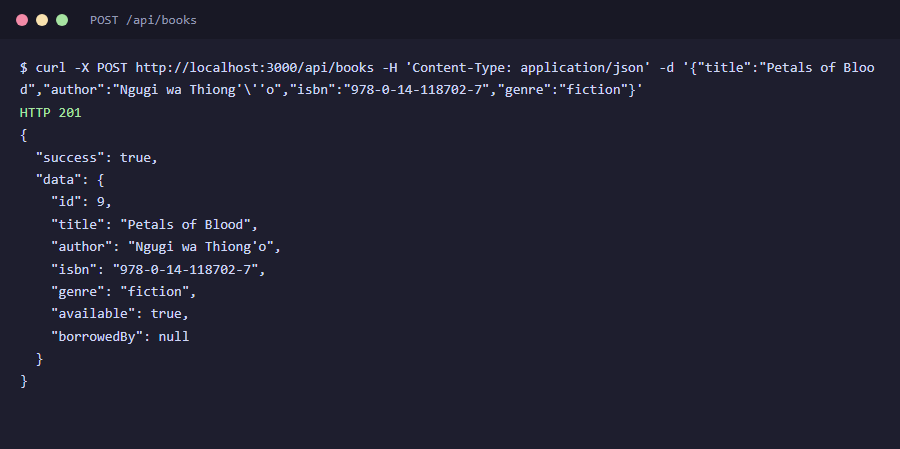

Missing fields return **400**, listing every field that is missing:

```bash
curl -X POST http://localhost:3000/api/books \
  -H 'Content-Type: application/json' \
  -d '{"title":"No Author"}'
```

```json
{
  "success": false,
  "error": "Missing or invalid fields: author, isbn, genre"
}
```

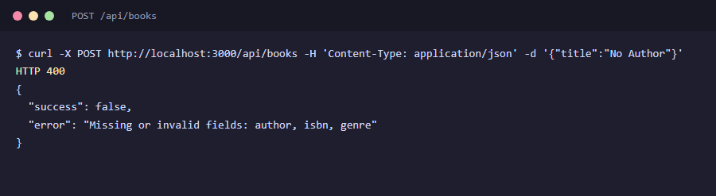

An invalid ISBN returns **400**:

```bash
curl -X POST http://localhost:3000/api/books \
  -H 'Content-Type: application/json' \
  -d '{"title":"Bad","author":"X","isbn":"abc","genre":"fiction"}'
```

```json
{
  "success": false,
  "error": "Invalid isbn. Use digits and dashes, at least 10 characters."
}
```

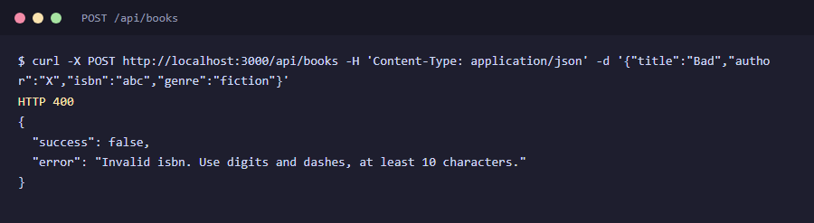

An ISBN that another book already has returns **409 Conflict**:

```bash
curl -X POST http://localhost:3000/api/books \
  -H 'Content-Type: application/json' \
  -d '{"title":"Copy","author":"X","isbn":"978-0-14-018650-2","genre":"fiction"}'
```

```json
{
  "success": false,
  "error": "A book with isbn 978-0-14-018650-2 already exists"
}
```

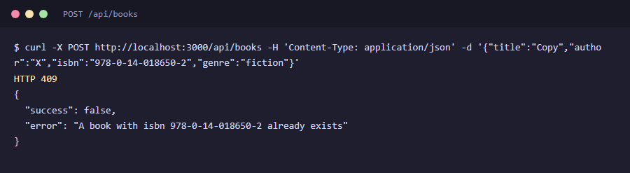

### 10. Update a book

`PUT` replaces the whole book, so every field is required:

```bash
curl -X PUT http://localhost:3000/api/books/3 \
  -H 'Content-Type: application/json' \
  -d '{"title":"Born a Crime","author":"Trevor Noah","isbn":"978-0-399-59043-2","genre":"memoir","available":true,"borrowedBy":null}'
```

```json
{
  "success": true,
  "data": {
    "id": 3,
    "title": "Born a Crime",
    "author": "Trevor Noah",
    "isbn": "978-0-399-59043-2",
    "genre": "memoir",
    "available": true,
    "borrowedBy": null
  }
}
```

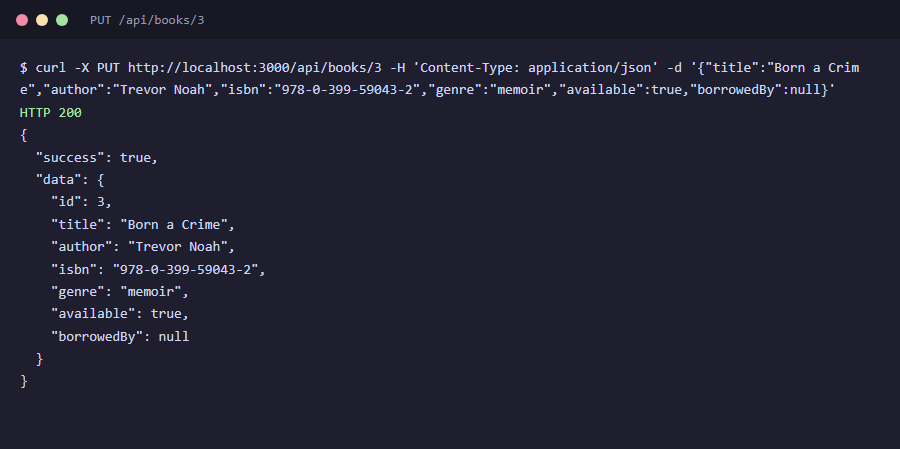

Leaving out `available` and `borrowedBy` returns **400**:

```bash
curl -X PUT http://localhost:3000/api/books/3 \
  -H 'Content-Type: application/json' \
  -d '{"title":"Born a Crime","author":"Trevor Noah","isbn":"978-0-399-59043-2","genre":"memoir"}'
```

```json
{
  "success": false,
  "error": "Missing or invalid fields: available, borrowedBy"
}
```

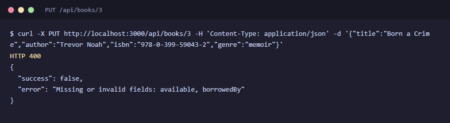

An available book can't have a borrower, so this returns **400**:

```bash
curl -X PUT http://localhost:3000/api/books/3 \
  -H 'Content-Type: application/json' \
  -d '{"title":"Born a Crime","author":"Trevor Noah","isbn":"978-0-399-59043-2","genre":"memoir","available":true,"borrowedBy":"Brian"}'
```

```json
{
  "success": false,
  "error": "borrowedBy must be null when the book is available"
}
```

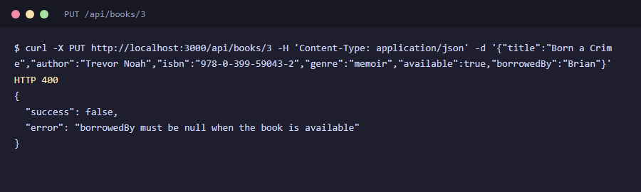

Using another book's ISBN returns **409**:

```bash
curl -X PUT http://localhost:3000/api/books/3 \
  -H 'Content-Type: application/json' \
  -d '{"title":"Born a Crime","author":"Trevor Noah","isbn":"978-0-14-018650-2","genre":"memoir","available":true,"borrowedBy":null}'
```

```json
{
  "success": false,
  "error": "A book with isbn 978-0-14-018650-2 already exists"
}
```

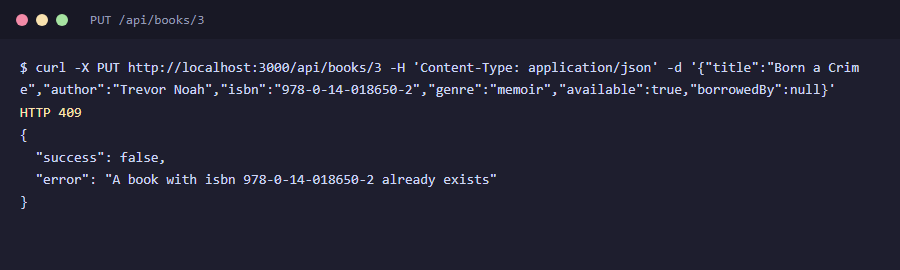

### 11. Borrow a book

```bash
curl -X POST http://localhost:3000/api/books/1/borrow \
  -H 'Content-Type: application/json' \
  -d '{"borrower":"Wanjiku"}'
```

```json
{
  "success": true,
  "data": {
    "id": 1,
    "title": "Weep Not, Child",
    "author": "Ngugi wa Thiong'o",
    "isbn": "978-0-14-018650-2",
    "genre": "fiction",
    "available": false,
    "borrowedBy": "Wanjiku"
  }
}
```

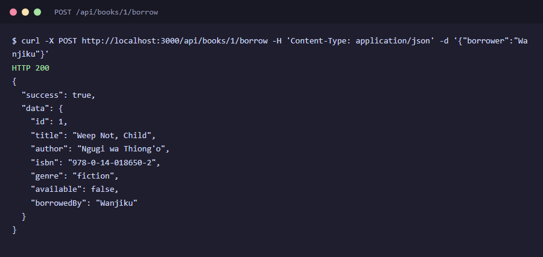

Borrowing the same book again returns **400** with the current borrower's name:

```bash
curl -X POST http://localhost:3000/api/books/1/borrow \
  -H 'Content-Type: application/json' \
  -d '{"borrower":"Brian"}'
```

```json
{
  "success": false,
  "error": "Book is already borrowed by Wanjiku"
}
```

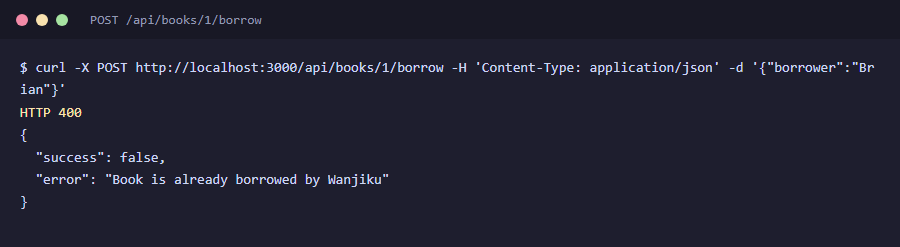

A missing `borrower` returns **400**:

```bash
curl -X POST http://localhost:3000/api/books/4/borrow \
  -H 'Content-Type: application/json' \
  -d '{}'
```

```json
{
  "success": false,
  "error": "Missing or invalid fields: borrower"
}
```

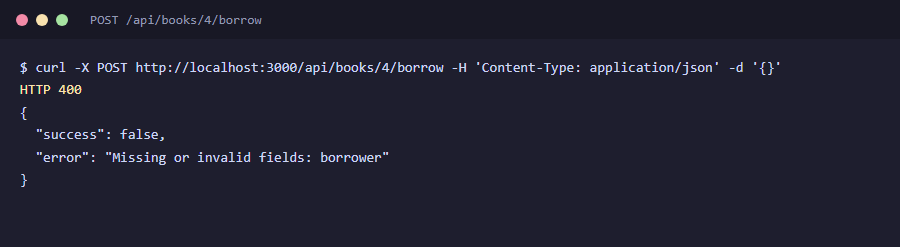

A book that doesn't exist returns **404**:

```bash
curl -X POST http://localhost:3000/api/books/99/borrow \
  -H 'Content-Type: application/json' \
  -d '{"borrower":"Wanjiku"}'
```

```json
{
  "success": false,
  "error": "No book found with id of 99."
}
```

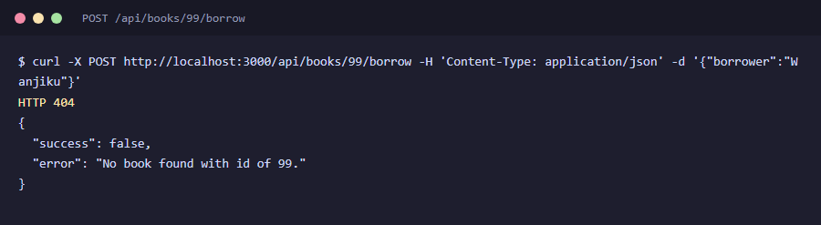

### 12. Return a book

```bash
curl -X POST http://localhost:3000/api/books/1/return
```

```json
{
  "success": true,
  "data": {
    "id": 1,
    "title": "Weep Not, Child",
    "author": "Ngugi wa Thiong'o",
    "isbn": "978-0-14-018650-2",
    "genre": "fiction",
    "available": true,
    "borrowedBy": null
  }
}
```

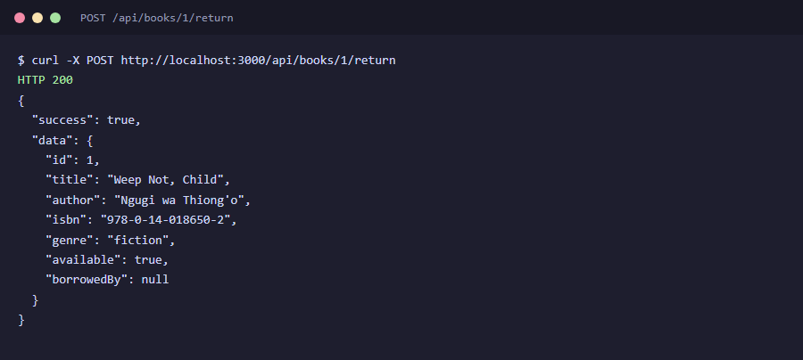

Returning a book that isn't borrowed returns **400**:

```bash
curl -X POST http://localhost:3000/api/books/1/return
```

```json
{
  "success": false,
  "error": "Book is not currently borrowed"
}
```

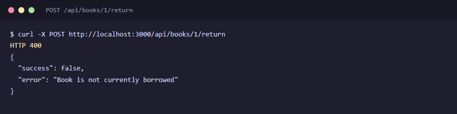

### 13. Delete a book

A borrowed book can't be deleted, so deleting book 2 returns **400**:

```bash
curl -X DELETE http://localhost:3000/api/books/2
```

```json
{
  "success": false,
  "error": "Cannot delete a book that is currently borrowed"
}
```

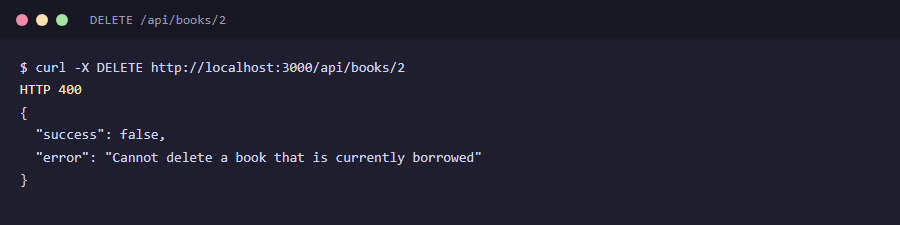

Deleting the book added in step 9 returns **200** with the deleted book:

```bash
curl -X DELETE http://localhost:3000/api/books/9
```

```json
{
  "success": true,
  "data": {
    "id": 9,
    "title": "Petals of Blood",
    "author": "Ngugi wa Thiong'o",
    "isbn": "978-0-14-118702-7",
    "genre": "fiction",
    "available": true,
    "borrowedBy": null
  }
}
```

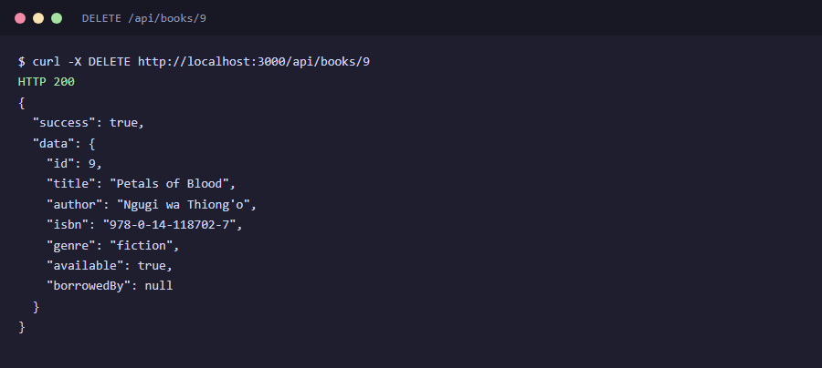

Deleting it again returns **404**:

```bash
curl -X DELETE http://localhost:3000/api/books/9
```

```json
{
  "success": false,
  "error": "No book with id of 9."
}
```

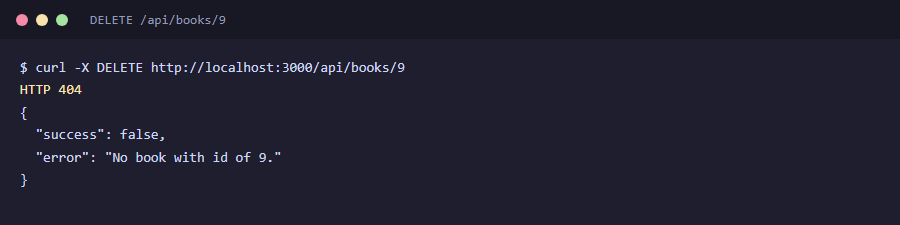

## Project structure

```
week-5-day-3-assignment/
├── server.js              # Express app, in-memory data and all routes
├── screenshots/           # curl output for each endpoint, used in this README
├── package.json
└── README.md
```
